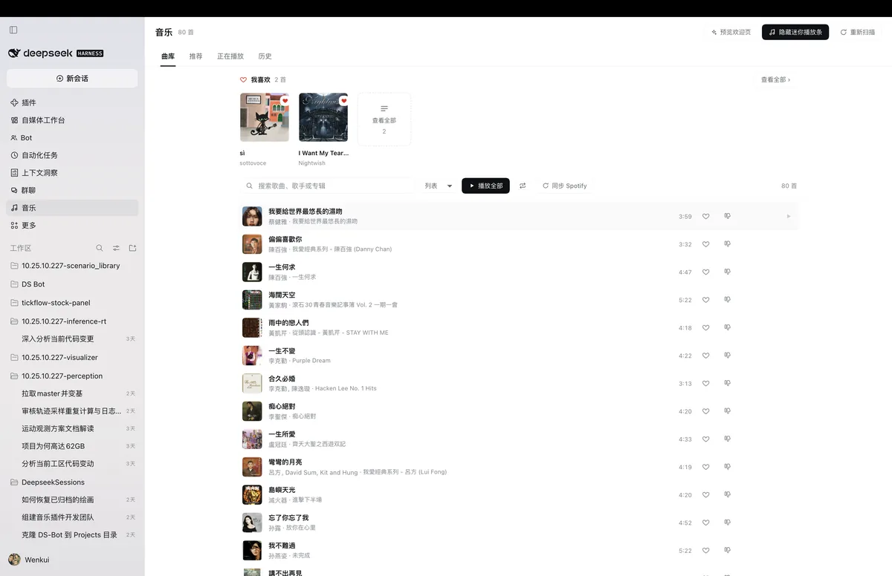
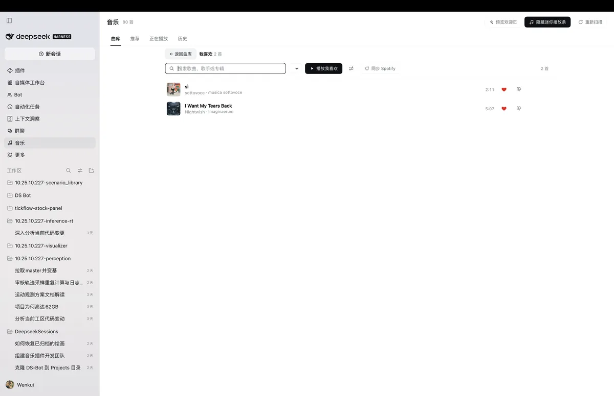
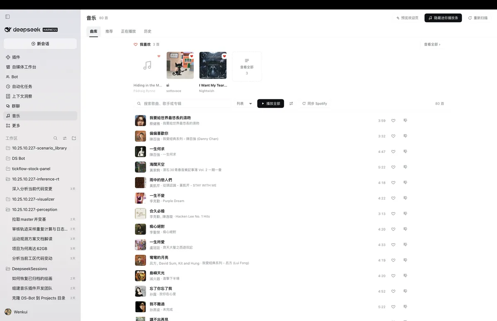

# dsh-music · ECHO 数字生命与本地音乐

<p align="center"></p>

DeepSeek Harness Desktop 的音乐插件。当前源码版本 **0.8.0-alpha.3** 将主体验改为 **ECHO 持续生命空间**：同一个数字生命始终在场，找歌、选歌、共同聆听和回看成长在它周围展开。每个生命有稳定的初生身份，本地音乐的真实播放特征逐渐影响它的比例、曲面、折叠与材质；你可以教它一个招呼、留下共同记忆、回看形态变化。曲库管理、歌词、歌手资料、联网推荐、喜欢入库、Spotify 收藏同步与策展功能继续保留。

这是可在本机运行的 alpha 原型；此处的版本号不代表已发布到 npm 或已安装到你的 Harness。完整行为、保存方式与开发接口见 [ECHO 说明](bundle/docs/ECHO.md)。

## 0.8.0-alpha.3 · ECHO

- **一个持续存在的空间**：主界面移除顶部页面导航和旧的固定播放器组件。找歌时，实际曲库结果在生命身旁展开；选择后收回，进入共同聆听。生命和播放器不会因这些状态切换而重建。
- **发现与回忆围绕同一身体**：一次呈现至多三首真实本地候选，依据喜欢和曲库记录选择；回看成长直接改变同一身体的历史形态，不写入档案、不改变播放。目录管理、在线发现、策展等复杂能力从「空间工具」按需打开。
- **无框伴生与克制的材质**：默认呈现完整生命，脚边保留播放、下一首和明确的音乐入口。身体用于招呼，印记用于回看记忆；音乐工具显式展开，歌词默认关闭。三种结构统一使用柔和主光、低饱和矿物色与温润表面，旧档案的身份和成长参数保持不变。
- **不同的初生身份与成长路径**：`fold`、`shell`、`ribbon` 是三种程序化形态语法。种子决定初始比例与响应差异，音乐经历影响后续形态。它们不是按流派分配的角色，也不是无限物种生成器。
- **从真实播放中成长**：仅接入本插件播放器中的本地曲库。能读取声音时，使用浏览器本地 FFT 的近似特征；特征不可用时只记录有效播放时长。暂停、静音、拖动进度和无法确认的长时间采样间隔不会被补算成成长。
- **主动留下关系**：介绍一首歌会保存分享记录，不会冒充已经听过；敲击招呼和共同记忆可以单独保存。没有连续签到、缺席扣分或离开后的退化。
- **本地规则与档案**：成长由版本化规则引擎驱动，不依赖 LLM 人格生成。档案在本机保存，可以导出 JSON；当前没有导入、跨设备同步或外部音乐平台自动收听接入。

## 形态样张

同样的三个个体、同样的模拟经历，对比 alpha.1 与 alpha.2 的绘制。膜片内部线条有明确边界，壳面减少网格纹路，带状身体的局部明暗跟随曲面。固定的伴生视口让展开与收拢保持一致的画面尺度。


下图由本版实际渲染器生成：九个独立起点接受同一段 20 分钟模拟声音输入，包含三种身体结构。这是可复现的形态样张，非宿主界面截图。


## 本地预览与开发

开发环境使用 Node.js 24.15 或更新的 24.x（也支持 22.22.2+ 的 22.x）。在仓库根目录执行：

```bash
npm ci
npm run build
npm run preview
```

浏览器打开 `http://127.0.0.1:4173`。预览使用实际构建出的插件客户端、生命规则和本地存档服务，曲库仅提供三段原创合成试听；不会扫描你的音乐目录或登录音乐平台。预览档案默认放在系统临时目录中的独立子目录，路径会输出到终端。需要保留预览档案时，可指定专用目录：

```bash
npm run preview -- --data-dir /绝对路径/echo-preview-data
```

不要将预览目录指向正式插件的数据目录。更改端口可用 `PORT=4174 npm run preview`。

前端源码在 `src/client/`，`npm run build` 生成 `bundle/client/index.js`。请修改源码后重新构建；直接编辑生成文件会被覆盖。安装到 Harness 时使用 `bundle/`，客户端从宿主模块表取得 React，包中不附带第二份 React 运行时。独立预览所需的 React 是仓库的开发依赖。

## 本轮验证（2026-11-21）

| 验证 | 结果 |
|---|---|
| 生命内核、音频观察、存档、材质渲染、持续空间、伴生交互、播放器与真实 HTTP/DOM 集成 | 96 项通过 |
| 生成客户端的曲库、历史、推荐、策展和伴生窗冒烟断言 | 93 项通过 |
| 分发包文件、文档和资源检查 | 15 项通过 |
| 实际 tgz 解包后的入口、模块图、生命规则和清单检查 | 23 项通过 |

在当前开发环境中执行 `npm test` 可重跑前三项。冷装检查针对 `npm pack` 得到的包，命令见 `tests/cold-install-smoke.mjs`。`npm run habitat-demo` 从实际主组件生成 `dist/echo-continuous-world.html` 交互演示，也可通过 `npm run habitat-demo -- /绝对路径/demo.html` 指定输出。演示使用本地内存中的示例曲目和模拟经历，不输出音频、不写正式档案。`npm run specimens` 重建九个生命样张，`npm run material-study` 重建固定个体的版本对照 SVG。形态样张由实际渲染器生成并进行了静态检查；它不代替真实浏览器的布局测试。

本轮尚未完成用户设备上的 Harness 安装、真实音频输出/FFT、窄屏布局和动画性能验收。DOM 集成测试使用媒体替身，未将其表述成真实声卡验证。伴生目前位于 Harness 应用内，尚无跨应用的原生桌面窗口。三个形态语法提供连续变化，但不保证任意两个生命永远肉眼可区分。多标签页共写、档案导入和跨设备同步尚未实现。

## 保留的音乐能力

- **音乐入口**：「找音乐」直接搜索本地曲库，当前曲目打开进度、歌词和偏好。空间中保留直接播放与下一首操作；切出面板后由音灵伴生窗继续控制同一队列。
- **策展台**：用「40 分钟的摇滚歌单」一类指令筛选本地曲库。支持私人电台、最近 30 天重听、按当前歌曲探索同歌手或流派，以及每日盲盒。私人电台生成至多 60 首连续播放的本地歌曲。
- **搜索与指令**：在生命空间内按 `⌘K` 或 `Ctrl+K` 聚焦找歌。原有 `/playlist`、`/radio`、`/history`、`/find`、`/daily` 保留在「空间工具 → 音乐指令」。
- **复杂工具**：曲库管理、联网发现、歌手资料、历史统计和来源设置保留原有业务界面，按需覆盖打开；这部分尚未完成与生命空间一致的视觉重构。
- **数据来源**：歌词、历史和画像使用现有插件的数据。曲库扫描新增对内嵌流派及语言标签的读取。明确指定流派或语言时只筛选匹配的标签。歌单和歌单名保存在当前 Harness 前端的本地存储中。
- **模型理解**：默认使用本地规则。可在本机 Harness 配置已有模型，界面勾选后仅发送输入的指令，选曲仍从本机完成。未开启或模型调用失败时可继续使用本地策展。

## 0.6.0 界面参考

| 曲库 | 推荐三栏 | 歌手页 |
| :---: | :---: | :---: |
|  |  |  |
|  |  |  |

- npm 包名：`@vicyangorg/dsh-music`；品牌名与 GitHub 仓库仍为 `dsh-music`（原名 `dsh-music` 在 npm 被占位包占用，故用 scoped 名，见 `docs/publishing.md`）
- 形态：DSH bundle（Host 服务 + Web 客户端面板）
- 历史验证记录（0.6.0）：一期 S1–S4、二期四批、三期、四期、五期、六期、七期、八期、九期、十期的验收证据为内部文档，含本机数据，不随公开仓库发布；不作为当前 alpha 的验证结论。
- 历史分发记录（0.6.0）：`@vicyangorg/dsh-music@0.6.0` 的 GitHub Release、npm 分发及插件目录 PR #15213 属于旧版本记录，当前 alpha 的构建与安装请使用本文步骤。

## 功能
| 模块 | 说明 |
|---|---|
| 曲库播放 | 扫描本地目录，封面/歌手/标题列表；播放/暂停/切歌/进度/音量；跨面板音灵伴生窗共用同一播放器 |
| 歌词 | 点击当前曲目可开启当前句；「完整歌词与队列」保留逐句同步高亮。来源为内嵌标签→LRCLIB→联网补齐；主空间和伴生歌词默认关闭，分别记住选择，无词时按实际状态降级。 |
| 歌手卡片 | 简介/近期动态/逸闻趣事（逐条注明来源与日期、区分事实与传闻）+ 相似歌手/歌曲 |
| 推荐 | **传统算法（零 LLM）**：7 相近 + 3 探索，探索位轮换流派/语言/年代/场景/意外之喜轴，避开高频歌手；每首经 MusicBrainz 联网核实、带推荐理由 |
| 下载 | 推荐歌曲经核实后下载到本地，带封面标签，自动入库即可播放；共享锁防并发 |
| Spotify 同步 | 一键同步收藏到本地，显示新增/缺失/失败；只经 spotify-sync CLI 间接用凭据 |
| 收听历史 | 记录播放完整度/跳过，仅存本地，作为推荐画像输入 |

## 历史版本功能记录

以下记录此前音乐插件的演进，部分入口和迷你窗样式在 ECHO alpha 中已重做；当前行为以本页开头及 ECHO 说明为准。

### 二期新增
| 模块 | 说明 |
|---|---|
| 迷你播放窗 | 右下角贴边不挡输入框；「关闭」仅隐藏、播放继续；面板可显示/隐藏，隐藏后悬浮球唤回 |
| 播放模式 | 单曲循环 / 顺序播放 / 随机播放 三态切换 |
| 推荐三栏目 | 今日推荐（7+3 反茧房）/ 歌手推荐 / 新歌推荐；不显示下载按钮，点播放时自动下载并播 |
| 曲库管理 | 行内删除（Spotify 收藏需二次确认、Apple Music 拒删）/ 在 Finder 显示 |
| 搜索 | 曲库页歌曲/歌手搜索（简繁归一+MusicBrainz 联网补全）；推荐页风格描述搜索（如「深夜爵士」，传统算法标签映射，零 LLM） |

### 三期新增（高颜值易操作）
| 模块 | 说明 |
|---|---|
| 推荐三栏并排 | 今日推荐/歌手推荐/新歌推荐三栏同时展示（各 20，列表式非 tab），每栏一键播放 |
| 喜欢才入库 | ♥ 喜欢标记；点喜欢才下载入库，点播放仅试听（缓存不入库）；取消喜欢不删文件 |
| 歌手页 | 歌手推荐 20 位，点击进独立歌手页：资料（简介/动态/逸闻，来源+日期）+ 歌曲列表 + 播放 + ♥ |
| 播放模式 | 单曲/顺序/随机三态常驻按钮 + 当前模式说明；迷你窗可切换 |
| 迷你播放窗 | 右下贴边不挡输入框；显示/隐藏幂等、无歌时禁用提示 |
| 核实防伪 | 下载/试听核实记录校验来源白名单 + musicbrainz 域名 + 本机留档比对，伪造拒绝 |

### 四期新增（视觉丰富度）
| 模块 | 说明 |
|---|---|
| 推荐封面图 | 今日/新歌推荐每行 38px 圆角封面（同曲库样式）；公开源 iTunes 搜索 API / 本地曲走曲库封面路由，无匹配时音符占位 |
| 歌手列表行 | 歌手栏列表形式、每位歌手一行：44px 圆形真实歌手/乐队照片（维基公开图）+ 名字 + 流派 + ›，整行可点进歌手页；无图图标占位，不用文字头像 |
| 歌手页视觉 | 132px 渐变横幅头图（`bannerUrl` ~1200px 适中尺寸，避免原图大图白屏）+ 96px 圆形大头像 + 资料（来源+日期）+ 带封面歌曲列表 |
| 图片兜底与缓存 | 全部图片 onError 兜底不裂图不破版；封面 URL 缓存 30 天、歌手图缓存本地（限流不缓存、确定性无图负缓存 3 天） |

### 五期新增（体验与统计）
| 模块 | 说明 |
|---|---|
| 曲库播放模式 | 工具栏单曲/顺序/随机三态段控件常驻 + 当前模式说明；「播放全部」跟随当前模式（随机态打乱队列并随机起播） |
| 统一搜索 | 删除歌曲/歌手类型下拉框，只保留分组下拉框；搜索同时命中歌名+歌手+专辑；联网补全 song+artist 并行合并去重，歌手项带 chip 可进歌手页 |
| 历史统计 | 新增 `GET /api/history/stats` 本地聚合：总播放/总时长/歌曲数/歌手数/跳过/平均完整度 + top 歌曲/top 歌手 + 近 7 天趋势；历史页六卡 + 纯 CSS 趋势柱 + Top 榜 |
| 历史视觉 | 日期分组行 + 40px 封面 + 完整度徽章（三档色）+ 跳过 chip + 时间；统计接口失败优雅降级不阻塞列表 |
| 布局紧凑 | 各页内容 max-width 居中（1120/1280/980）、间距收紧一档；窄屏 980/680/560 断点降级，推荐三栏塌单列不溢出 |

### 六期新增（迷你窗/冷启动/分发就绪）
| 模块 | 说明 |
|---|---|
| 迷你播放条 | ×=隐藏（无悬浮球）直到工具栏「显示迷你播放条」，播放不断；独立收起/展开（收起细条+1 行歌词、展开进度条+3 行歌词高亮）；握把拖动位置持久化；进度可拖 seek |
| 播放模式 | 全端单个循环点击按钮（顺序→随机→单曲循环），图标+title 说明当前态 |
| 列表播放 | 任何列表（含历史）「播放该列表」；点任何单曲整列入队并立即切播 |
| 歌手统一 | 任何地方点歌手进同一歌手页；歌手名 hover pointer；六处真实头像（分组头/搜索chip/相似/正在播放/迷你/历史） |
| 冷启动 | 零历史出探索批（≥6 首逐首联网核实+中文说明）；空态引导「搜歌手/歌名试听」；二进制 PATH 自动探测+中文安装引导；Spotify 同步标可选 |
| 分发就绪 | 公开包名 dsh-music、MIT、engines.dsh、8 语 meta.detail、用户向 DETAIL+截图+README；打包守门+冷装冒烟脚本入回归 |

### 七期新增（悬浮标/欢迎页/社区设计）
| 模块 | 说明 |
|---|---|
| 悬浮标 | 迷你条可收起为可拖悬浮标（位置持久），点击恢复展开；×=隐藏直到工具栏「显示迷你播放条」；迷你条/悬浮标位于应用内全局顶层（fixed+body 级挂载），任何页面/面板/弹窗不遮挡；跨应用悬浮 web GUI 不可实现，已如实说明 |
| 统一试听 | 全部「下载并播放」统一为试听语义（试听不入库），喜欢才下载入库；8 语零「下载并播放」类文案 |
| 常听列表播放 | 常听歌曲「播放该列表」+行点击立即切播；不在库行置灰并提示 |
| 欢迎页 | 蓝色大肥鱼戴耳机原创 logo；首启个性化（流派/语言偏好）→ 设本地目录进曲库，或一键建 starter 曲库（4 首公有领域曲目，逐首许可核实+署名）进推荐；老用户不被打扰，设置内可预览欢迎页 |
| taste 软偏置 | 偏好被推荐消费：探索批按偏好流派/语言软偏置，不锁死多样性 |
| 社区设计稿 | `docs/community-design.md`：分享卡片/分享码/GitHub Discussions 广场，opt-in、无后端、数据不出机（本期仅设计） |

### 八期新增（真新歌/全流派/喜欢与不喜欢/品牌 logo）
| 模块 | 说明 |
|---|---|
| 新歌真发行 | 新歌推荐只推真正新发行（180 天内、MusicBrainz 真实首发日期，区分专辑/单曲/EP），不再把「刚入库的歌」当新歌；来源拓宽到高频歌手→相似歌手→口味流派直查，过滤库内/近期已荐/不喜欢，按真实发行日降序 |
| 流派全覆盖 | 欢迎页流派 10→15（补 pop/rock/hip hop/punk/country），推荐池 `GENRE_POOLS` 同步补全（逐首 MusicBrainz 核实），taste 软偏置生效 |
| 我喜欢列表 | 曲库「曲库 / 我喜欢(N)」双 Tab，喜欢的歌独立成列，行点击立即切播，不在库行置灰 |
| 不喜欢 | 每首歌（曲库/推荐/新歌/歌手页）可「不喜欢」👎；与喜欢互斥（二值口味信号）；不喜欢不下载、不删文件；推荐避开不喜欢的歌与歌手 |
| 不喜欢进统计 | 不喜欢计入收听统计历史（独立口味事件，默认不污染播放画像）；历史页统计卡新增不喜欢计数 +「不喜欢的歌」列表（可取消不喜欢） |
| 品牌 logo | 用户提供的蓝肥鱼戴耳机图设为插件 logo（Plugin Manager 清单页 / 插件目录 / README） |

### 九期新增（卡片架/跨页同步/后台加载与双层缓存）
| 模块 | 说明 |
|---|---|
| 我喜欢卡片架 | 曲库页顶部横向封面卡片架展示「我喜欢」（≤12 张横滑 +「查看全部」进完整列表），取代常驻双 Tab；无喜欢时空态引导 |
| 跨页喜欢同步 | 任何页面（曲库/推荐/新歌/歌手页/搜索）点 ♥，回曲库卡片架即时同步并置顶新喜欢；取消喜欢同步移除 |
| 后台加载 | 离开加载中的歌手页加载在后台继续；完成后 toast 提示「歌手页已就绪」，点击 toast 直达该歌手页 |
| 双层缓存 | 歌手页等内容客户端会话缓存（同会话重开秒开、pending 去重、失败不缓存可重试）+ Host 持久缓存（歌手资料/维基兜底回写/相似/图 30 天、核验 30 天、确定性未命中负缓存 3 天，重复打开零重复网络拉取），重启后仍命中 |
| 歌手页文案 | 歌手页歌曲区标题「的歌曲」改为「歌曲」（8 语同步） |

### 十期新增（推荐按天固化/每栏重新推荐/播放转圈反馈）
| 模块 | 说明 |
|---|---|
| 推荐按天固化 | 三栏（今日/歌手/新歌）按本地自然日缓存：当天首次进推荐页生成一次，之后切换进来零重算秒开；跨天首次进入自动生成新批 |
| 每栏重新推荐 | 每栏标题行「重新推荐」按钮只重算本栏，其余两栏不受影响；重算期间该栏独立显示进度 |
| 播放转圈反馈 | 点行播放 ▶ 变转圈（试听准备中），就绪恢复播放态；「播放本栏」整栏转圈、逐首就绪逐首恢复；转圈期间防重复点击 |

## 安装本地改版

先在仓库根目录执行 `npm ci` 和 `npm run build`。以下假设项目放在 `~/Projects/dsh-music`，安装目标是其中的 `bundle/` 目录；如果路径不同，请换成实际路径。

**Harness Desktop**：在 Harness 内调用插件管理工具，将目标换成实际绝对路径。成功状态为 `application: applied`。

```text
plugin_manager install_bundle target=link:/Users/你的用户名/Projects/dsh-music/bundle
```

**Harness Web**（沿用 0.7.0 本地改版的 CLI 安装方式）：

```bash
dsh plugin --profile web add "link:$HOME/Projects/dsh-music/bundle"
dsh web
```

打开或刷新 Harness，并在侧栏进入「音乐」。已有同名插件时，安装目标是更新原插件的本地来源，插件的数据目录沿用原路径。当前版本为 `0.8.0-alpha.3`。之后修改 `src/client/` 时，先重新执行 `npm run build`，再刷新或重新启用插件。

### 可选的 Harness 模型理解

在 Harness Web 的本机 loopback profile 使用如下覆盖文件，让 `curationProvider` 和 `curationModel` 对应该 profile 已注册的 provider ID 和 model ID。如果已配置音乐目录，也保留相应的 `config` 项。

```yaml
- id: dsh-music
  config:
    curationProvider: "填写已注册的 provider ID"
    curationModel: "填写该 provider 的 model ID"
```

将文件命名为 `music-model.yml`，运行 `dsh web --patch ./music-model.yml`。在「智能歌单」或「私人电台」勾选「使用 Harness 模型理解指令」。无需在插件内填密钥。

## 使用
1. 点左侧栏「音乐」打开面板，曲库自动扫描。
2. 点曲目播放；正在播放页可看同步歌词、点歌手名打开歌手卡片。
3. 「推荐」页点「生成推荐」→ 得到 7 相近 + 3 探索，逐首可「试听」（不入库）；点 ♥ 喜欢才下载入库。
4. 入库队列看进度，完成后自动入库可播放。
5. 曲库工具栏「同步 Spotify」一键同步收藏。
6. 「历史」页查看收听记录。

## 数据位置

以下为默认路径；配置 `dataDir` 后，状态档案改用配置的目录。ECHO 的音频特征计算与生命存档在本机完成。原有歌词、推荐、下载和可选模型功能仍按各自配置访问网络。

| 路径 | 内容 |
|---|---|
| `~/Music/dsh-music/` | 喜欢入库的歌曲（本插件写入） |
| `~/Music/dsh-music/starter/` | 欢迎页 starter 曲库（公有领域，署名见 `~/.dsh/dsh-music/starter.json`） |
| `~/Music/spotify-liked/` | Spotify 收藏（仅 spotify-sync CLI 写入，本插件不改） |
| `~/.dsh/dsh-music/history.jsonl` | 收听历史 |
| `~/.dsh/dsh-music/cache/` | 歌词/歌手/推荐发现/核实/封面与歌手图缓存 |
| `~/.dsh/dsh-music/reco-history.json` | 推荐批次留档 |
| `~/.dsh/dsh-music/echo-life.json` | ECHO 初生状态、已接受事件与当前生命状态 |

ECHO 的「共同记忆 → 导出生命档案」可以下载已保存的档案。当前没有导入界面；导出不等于已经具备自动恢复或跨设备迁移能力。容量与保存失败的处理见 [ECHO 说明](bundle/docs/ECHO.md#保存导出与容量)。

## 卸载
```
plugin_manager remove_bundle  target=@vicyangorg/dsh-music
```
如需清理数据，手动删除上表所列目录（`~/Music/dsh-music/`、`~/.dsh/dsh-music/`）；`~/Music/spotify-liked/` 是否保留由您决定。

## 已知限制

- ECHO 的声音特征是本地 FFT 近似值，不用于情绪诊断；三种结构语法与有限参数空间不保证任意两个生命在任何时刻都具有肉眼可分辨的外形。成长不会生成 LLM 人格，也不会自动读取 Spotify、Apple Music 或其他应用的播放活动。
- ECHO 当前最多保存 100,000 条已接受事件、64 段共同记忆、96 个时间线节点，存档最大 64 MiB。达到事件或文件容量上限时停止接受新事件，已保存档案仍可查看与导出。
- 音源上限 YT Music ~128k AAC；个别曲目源头无封面或时长与 MusicBrainz 目标略有出入（软警告，仍可播放）。
- 推荐为传统算法 + MusicBrainz 发现，探索多样性依赖曲库与历史规模；不依赖任何 LLM。
- Spotify 取消收藏不触发本地删除，是否删本地文件由您决定。

## 红线（设计约束）
不并发下载管线；绝不查看/移动/删除 `~/.config/spotify-sync/refresh_token`；推荐候选先联网核实再下载；推荐下载只写 `~/Music/dsh-music/`；歌手内容注明来源与日期；历史/缓存仅存本地。
