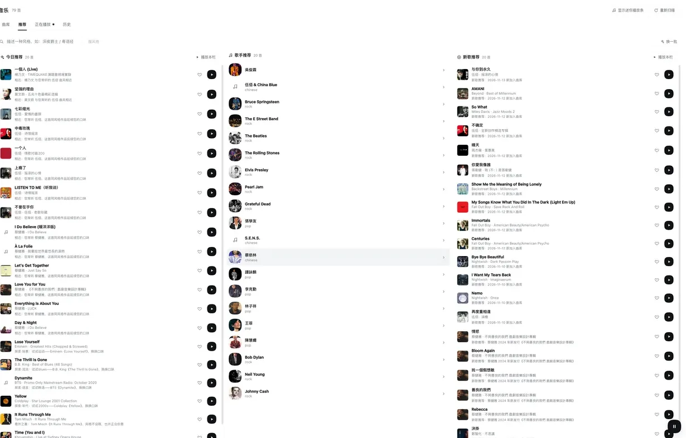
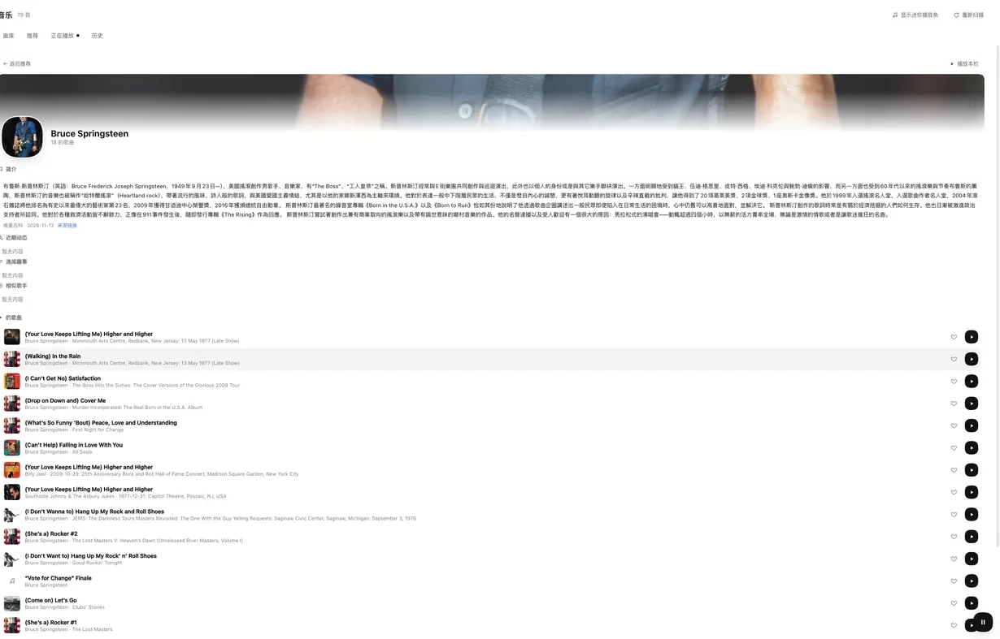

# dsh-music · 本地音乐插件

<p align="center"></p>

DeepSeek Harness Desktop 的音乐插件：播放本地曲库、同步歌词与歌手故事、基于收听历史的反信息茧房推荐、推荐歌曲试听/喜欢才入库、Spotify 收藏同步。界面简约、中文、跟随明暗主题。

## 预览

| 曲库 | 推荐三栏 | 歌手页 |
| :---: | :---: | :---: |
| 曲库（我喜欢卡片架） | 推荐三栏 | 歌手页 |
| :---: | :---: | :---: |
|  |  |  |
|  |  |  |

- npm 包名：`@vicyangorg/dsh-music`（v0.8.2）；品牌名与 GitHub 仓库仍为 `dsh-music`（原名 `dsh-music` 在 npm 被占位包占用，故用 scoped 名，见 `docs/publishing.md`）
- 形态：DSH bundle（Host 服务 + Web 客户端面板）
- 验证状态：一期～十四期均已验收通过（验收证据为内部文档，含本机数据，不随公开仓库发布）；`v0.8.2` 的面板背景预设、历史实时刷新与桌面歌词跳转修复均通过全套自动化测试（歌词跳转经真实桌面端复验），详见 `docs/publishing.md` §12–§14
- 分发状态：`@vicyangorg/dsh-music@0.8.2` 已发布 GitHub Release + npm（MIT/engines.dsh/8 语 meta/DETAIL+截图/README，打包守门+冷装冒烟通过）

## 功能
| 模块 | 说明 |
|---|---|
| 曲库播放 | 扫描本地目录，封面/歌手/标题列表；播放/暂停/切歌/进度/音量；跨页迷你播放条 |
| 歌词 | 内嵌标签→LRCLIB→联网补齐，逐句同步滚动高亮；无词时优雅降级「暂无歌词，仅播放」 |
| 歌手卡片 | 简介/近期动态/逸闻趣事（逐条注明来源与日期、区分事实与传闻）+ 相似歌手/歌曲 |
| 推荐 | **传统算法（零 LLM）**：7 相近 + 3 探索，探索位轮换流派/语言/年代/场景/意外之喜轴，避开高频歌手；每首经 MusicBrainz 联网核实、带推荐理由 |
| 下载 | 推荐歌曲经核实后下载到本地，带封面标签，自动入库即可播放；共享锁防并发 |
| Spotify 同步 | 一键同步收藏到本地，显示新增/缺失/失败；只经 spotify-sync CLI 间接用凭据 |
| 喜欢列表导入 | 网易云音乐 / QQ 音乐都支持**手机扫码**登录（QQ 也保留粘贴 Cookie），把两平台的「我喜欢」**只读**导入到本地 ♥ 列表：不下载、不改云端账号、不取消本地 ♥ |
| 收听历史 | 记录播放完整度/跳过，仅存本地，作为推荐画像输入 |

## 二期新增
| 模块 | 说明 |
|---|---|
| 迷你播放窗 | 右下角贴边不挡输入框；「关闭」仅隐藏、播放继续；面板可显示/隐藏，隐藏后悬浮球唤回 |
| 播放模式 | 单曲循环 / 顺序播放 / 随机播放 三态切换 |
| 推荐三栏目 | 今日推荐（7+3 反茧房）/ 歌手推荐 / 新歌推荐；不显示下载按钮，点播放时自动下载并播 |
| 曲库管理 | 行内删除（Spotify 收藏需二次确认、Apple Music 拒删）/ 在 Finder 显示 |
| 搜索 | 曲库页歌曲/歌手搜索（简繁归一+MusicBrainz 联网补全）；推荐页风格描述搜索（如「深夜爵士」，传统算法标签映射，零 LLM） |

## 三期新增（高颜值易操作）
| 模块 | 说明 |
|---|---|
| 推荐三栏并排 | 今日推荐/歌手推荐/新歌推荐三栏同时展示（各 20，列表式非 tab），每栏一键播放 |
| 喜欢才入库 | ♥ 喜欢标记；点喜欢才下载入库，点播放仅试听（缓存不入库）；取消喜欢不删文件 |
| 歌手页 | 歌手推荐 20 位，点击进独立歌手页：资料（简介/动态/逸闻，来源+日期）+ 歌曲列表 + 播放 + ♥ |
| 播放模式 | 单曲/顺序/随机三态常驻按钮 + 当前模式说明；迷你窗可切换 |
| 迷你播放窗 | 右下贴边不挡输入框；显示/隐藏幂等、无歌时禁用提示 |
| 核实防伪 | 下载/试听核实记录校验来源白名单 + musicbrainz 域名 + 本机留档比对，伪造拒绝 |

## 四期新增（视觉丰富度）
| 模块 | 说明 |
|---|---|
| 推荐封面图 | 今日/新歌推荐每行 38px 圆角封面（同曲库样式）；公开源 iTunes 搜索 API / 本地曲走曲库封面路由，无匹配时音符占位 |
| 歌手列表行 | 歌手栏列表形式、每位歌手一行：44px 圆形真实歌手/乐队照片（维基公开图）+ 名字 + 流派 + ›，整行可点进歌手页；无图图标占位，不用文字头像 |
| 歌手页视觉 | 132px 渐变横幅头图（`bannerUrl` ~1200px 适中尺寸，避免原图大图白屏）+ 96px 圆形大头像 + 资料（来源+日期）+ 带封面歌曲列表 |
| 图片兜底与缓存 | 全部图片 onError 兜底不裂图不破版；封面 URL 缓存 30 天、歌手图缓存本地（限流不缓存、确定性无图负缓存 3 天） |

## 五期新增（体验与统计）
| 模块 | 说明 |
|---|---|
| 曲库播放模式 | 工具栏单曲/顺序/随机三态段控件常驻 + 当前模式说明；「播放全部」跟随当前模式（随机态打乱队列并随机起播） |
| 统一搜索 | 删除歌曲/歌手类型下拉框，只保留分组下拉框；搜索同时命中歌名+歌手+专辑；联网补全 song+artist 并行合并去重，歌手项带 chip 可进歌手页 |
| 历史统计 | 新增 `GET /api/history/stats` 本地聚合：总播放/总时长/歌曲数/歌手数/跳过/平均完整度 + top 歌曲/top 歌手 + 近 7 天趋势；历史页六卡 + 纯 CSS 趋势柱 + Top 榜 |
| 历史视觉 | 日期分组行 + 40px 封面 + 完整度徽章（三档色）+ 跳过 chip + 时间；统计接口失败优雅降级不阻塞列表 |
| 布局紧凑 | 各页内容 max-width 居中（1120/1280/980）、间距收紧一档；窄屏 980/680/560 断点降级，推荐三栏塌单列不溢出 |

## 六期新增（迷你窗/冷启动/分发就绪）
| 模块 | 说明 |
|---|---|
| 迷你播放条 | ×=隐藏（无悬浮球）直到工具栏「显示迷你播放条」，播放不断；独立收起/展开（收起细条+1 行歌词、展开进度条+3 行歌词高亮）；整条可拖（把手 / 标题 / 歌词 / 空白处按下移动即拖，播放等控件按钮与滑块不参与；轻点标题仍是打开正在播放），位置持久化；进度可拖 seek |
| 播放模式 | 全端单个循环点击按钮（顺序→随机→单曲循环），图标+title 说明当前态 |
| 列表播放 | 任何列表（含历史）「播放该列表」；点任何单曲整列入队并立即切播 |
| 歌手统一 | 任何地方点歌手进同一歌手页；歌手名 hover pointer；六处真实头像（分组头/搜索chip/相似/正在播放/迷你/历史） |
| 冷启动 | 零历史出探索批（≥6 首逐首联网核实+中文说明）；空态引导「搜歌手/歌名试听」；二进制 PATH 自动探测+中文安装引导；Spotify 同步标可选 |
| 分发就绪 | 公开包名 dsh-music、MIT、engines.dsh、8 语 meta.detail、用户向 DETAIL+截图+README；打包守门+冷装冒烟脚本入回归 |

## 七期新增（悬浮标/欢迎页/社区设计）
| 模块 | 说明 |
|---|---|
| 悬浮标 | 迷你条可收起为可拖悬浮标（位置持久），点击恢复展开；×=隐藏直到工具栏「显示迷你播放条」；迷你条/悬浮标位于应用内全局顶层（fixed+body 级挂载），任何页面/面板/弹窗不遮挡；跨应用悬浮 web GUI 不可实现，已如实说明 |
| 统一试听 | 全部「下载并播放」统一为试听语义（试听不入库），喜欢才下载入库；8 语零「下载并播放」类文案 |
| 常听列表播放 | 常听歌曲「播放该列表」+行点击立即切播；不在库行置灰并提示 |
| 欢迎页 | 七期首启流程（已被十二期「设置页」取代：首启进设置页，顶部用插件真实 Logo） |
| taste 软偏置 | 偏好被推荐消费：探索批按偏好流派/语言软偏置，不锁死多样性 |
| 社区设计稿 | `docs/community-design.md`：分享卡片/分享码/GitHub Discussions 广场，opt-in、无后端、数据不出机（本期仅设计） |

## 八期新增（真新歌/全流派/喜欢与不喜欢/品牌 logo）
| 模块 | 说明 |
|---|---|
| 新歌真发行 | 新歌推荐只推真正新发行（180 天内、MusicBrainz 真实首发日期，区分专辑/单曲/EP），不再把「刚入库的歌」当新歌；来源拓宽到高频歌手→相似歌手→口味流派直查，过滤库内/近期已荐/不喜欢，按真实发行日降序 |
| 流派全覆盖 | 欢迎页流派 10→15（补 pop/rock/hip hop/punk/country），推荐池 `GENRE_POOLS` 同步补全（逐首 MusicBrainz 核实），taste 软偏置生效 |
| 我喜欢列表 | 曲库「曲库 / 我喜欢(N)」双 Tab，喜欢的歌独立成列，行点击立即切播，不在库行置灰 |
| 不喜欢 | 每首歌（曲库/推荐/新歌/歌手页）可「不喜欢」👎；与喜欢互斥（二值口味信号）；不喜欢不下载、不删文件；推荐避开不喜欢的歌与歌手 |
| 不喜欢进统计 | 不喜欢计入收听统计历史（独立口味事件，默认不污染播放画像）；历史页统计卡新增不喜欢计数 +「不喜欢的歌」列表（可取消不喜欢） |
| 品牌 logo | 用户提供的蓝肥鱼戴耳机图设为插件 logo（Plugin Manager 清单页 / 插件目录 / README）；日常界面落点：侧栏全局入口（18px，选中加圆角底色）、面板报头 wordmark（22px）、空曲库/空历史/推荐冷启动/现在播放空闲（44px）、迷你 FAB 无封面兜底（34px）；尺寸内联驱动，≥40px 才加投影，取不到图退回内嵌 FishLogo |
| 面板背景 | 默认整面板铺半透明蓝底（插件品牌蓝 #1a5bf6、与小鱼同色，26→12→8% 径向渐变，右下角最浓）+ 小蓝鱼水印（18% 透明度、锚右下角、随面板宽度 40cqw 缩放），迷你播放条同铺蓝底小鱼、悬浮球只上蓝底；设置页「面板背景」五套预设（小蓝鱼/素净/晨雾/暖沙/唱片；素净=7% 点阵纸纹、晨雾=三层横向雾带 14/16/10%、暖沙=底部双沙丘拱+暖天光 20/16/6%，各有可识别母题）点选立即生效；历史统计卡/常听卡/推荐卡/设置 provider 卡等大面内容改 66% 半透明、sticky 表头 82%+磨砂，背景不被白卡割裂，单一 ui.bg + prefs 持久化保证面板/迷你条/悬浮球同步；背景层 pointer-events:none 不接事件，内容抬到其上 |

## 九期新增（卡片架/跨页同步/后台加载与双层缓存）
| 模块 | 说明 |
|---|---|
| 我喜欢卡片架 | 曲库页顶部横向封面卡片架展示「我喜欢」（≤12 张横滑 +「查看全部」进完整列表），取代常驻双 Tab；无喜欢时空态引导 |
| 跨页喜欢同步 | 任何页面（曲库/推荐/新歌/歌手页/搜索）点 ♥，回曲库卡片架即时同步并置顶新喜欢；取消喜欢同步移除 |
| 后台加载 | 离开加载中的歌手页加载在后台继续；完成后 toast 提示「歌手页已就绪」，点击 toast 直达该歌手页 |
| 双层缓存 | 歌手页等内容客户端会话缓存（同会话重开秒开、pending 去重、失败不缓存可重试）+ Host 持久缓存（歌手资料/维基兜底回写/相似/图 30 天、核验 30 天、确定性未命中负缓存 3 天，重复打开零重复网络拉取），重启后仍命中 |
| 歌手页文案 | 歌手页歌曲区标题「的歌曲」改为「歌曲」（8 语同步） |

## 十期新增（推荐按天固化/每栏重新推荐/播放转圈反馈）
| 模块 | 说明 |
|---|---|
| 推荐按天固化 | 三栏（今日/歌手/新歌）按本地自然日缓存：当天首次进推荐页生成一次，之后切换进来零重算秒开；跨天首次进入自动生成新批 |
| 每栏重新推荐 | 每栏标题行「重新推荐」按钮只重算本栏，其余两栏不受影响；重算期间该栏独立显示进度 |
| 播放转圈反馈 | 点行播放 ▶ 变转圈（试听准备中），就绪恢复播放态；「播放本栏」整栏转圈、逐首就绪逐首恢复；转圈期间防重复点击 |

## 十一期新增（网易云 / QQ 音乐喜欢列表导入）
| 模块 | 说明 |
|---|---|
| 网易云扫码登录 | 设置页的网易云卡片内本地生成二维码（自带零依赖 QR 编码器，SVG 渲染），手机 App 扫码确认即连上；登录态只存本机 `accounts.json`（权限 0600） |
| QQ 音乐扫码登录 | 走 QQ 音乐网页版同款链路（ptlogin 二维码 → 手机 QQ 扫一扫 → QQ Connect 授权换登录态），二维码图片由主机解成模块矩阵后同样以 SVG 渲染；微信登录的账号扫不了，行内可一键切回「粘贴 Cookie」三步 |
| 只读导入 | 「导入到「我喜欢」」把两平台喜欢列表与本地 ♥ 合并：新增 ♥ / 已有 ♥ / 本地 👎 跳过 / 云端已下架 / 云端已移除（仅提示）；行内显示来源小标（网易云 / QQ 音乐） |
| 增量 | 记住每个平台的歌曲 id，再次导入只处理差异；断开连接保留 ♥ 标记 |
| 主机开关 | `config.likedSync = false` 可整体关闭（默认开启但完全被动：不连接就不发任何请求） |

## 十二期新增（设置页统一入口）
| 模块 | 说明 |
|---|---|
| 设置页 | 面板右上角「设置」（齿轮）一个入口收齐三块：「喜欢列表同步」（网易云 / QQ 音乐 / Spotify 三行手风琴，行头直接写状态：等待扫码… / 已就绪 / 未安装…）、「推荐口味」（流派/语言多选）、「音乐库」（已有目录 / starter 曲库 / 自定义路径）；曲库工具栏不再散落「同步 Spotify」「导入喜欢列表」按钮，只在同步进行中显示一个回到设置的状态钮 |
| 分步引导 | 每个平台展开后是编号步骤（①②③ + 当前步高亮）：网易云 = ①手机扫码登录 → ②登录后自动导入；QQ 音乐 = ①手机 QQ 扫一扫 → ②登录后自动导入（微信登录的账号切到 Cookie 三步：①浏览器登录 y.qq.com（一键打开）→ ②「复制命令」后到 y.qq.com 的 Console 里粘贴回车 → ③粘贴到这里**自动连接并导入**）；Spotify = ①检测到 spotify-sync 命令行 → ②完成授权（只检查凭据文件是否存在，从不读取）→ ③同步收藏到本地曲库，缺哪步标红并给「重新检测」 |
| 导入结果 | 一行主结论「已导入 N 首到「我喜欢」：新增 a，之前已有 b」+ 只有异常才出现的提示 chip（云端已移除 / 已下架 / 本地 👎 跳过）+「查看「我喜欢」」；错误只显示在对应平台那一行 |
| 未入库的导入曲目 | 「我喜欢」页头显示「N 首还没入库」和「入库 N 首」批量按钮，行尾有「入库」按钮；**直接点这些歌也会先入库**：按歌手 + 歌名联网搜一次，歌名一致且歌手覆盖最多的已核实（MusicBrainz 归档）音源才进下载队列，否则提示去曲库搜索——导入本身仍然只标 ♥ |
| 入库状态悬浮面板 | 任何来源（♥、导入曲目的「入库」/「入库 N 首」）的下载都显示在**右下角悬浮面板**（十三期起，见下）：有批次在跑时自动弹出，逐首显示排队中 / 入库中 / 已入库 / 已存在 / 失败（带原因），进度条 + 「已完成 / 总数」；可收起成一枚进度胶囊、可关闭；结束后列出汇总，已入库的歌可直接播放，一键「打开曲库」 |
| 首启即设置 | 首次进入（曲库为空且未完成设置）自动打开设置页：顶部是插件真实 Logo（主机 `GET /dsh-music/icon.png` 提供包内 `icon.png`，取不到才退回内嵌图形）+ 欢迎语 + 三条要点；底部「先随便看看 / 完成」。「完成」= 原欢迎流程收尾：口味 + 曲库选择一起保存，选 starter 则就地显示下载进度再进推荐 |
| 老用户保存 | 老用户改完点「保存设置」只写口味/目录（主机对已就绪的 starter 不重复下载，failed/skipped 才会重试）；「我喜欢」页的入口直接滚到「喜欢列表同步」区块 |
| 原预览欢迎页 | 已移除（「预览欢迎页」按钮与 welcome 多步向导一并下线，`welcome` 相关 i18n 键同步清理） |

## 十三期新增（下载队列 + 迷你条/正在播放的喜欢按钮）
| 模块 | 说明 |
|---|---|
| 下载队列（置顶） | 主机下载改成真正的队列：有批次在跑时再点入库不再被 409 拒绝，而是**并进当前批次**——「我喜欢」里点一首还没入库的歌 → 立刻搜已核实的音源 → **插到待下载列表最前面**（当前这首下完就轮到它）；行尾「入库」同样置顶；「入库 N 首」批量排到队尾。进度面板实时多出「排队中」的行；单次请求仍 ≤20 首、仍走 MusicBrainz 核实归档，与 spotify-sync 共用管线锁 |
| 入库状态悬浮面板 → 右下角 | 面板与胶囊改到**右下角**，和迷你播放条同一条右边线；迷你条在默认角落时自动叠在它上方（迷你条被拖走/隐藏/缩成悬浮标时就贴回角落）。逐首状态、进度条、播放、「打开曲库」不变 |
| 迷你条 ♥ / 👎 | 迷你播放条控制区（下一首之后）新增喜欢 / 不喜欢，与曲库行、正在播放页同一套语义（喜欢才入库、不喜欢从推荐剔除）；条宽 380 → 420 保证标题不被挤没 |
| 正在播放页 ♥ / 👎 | 歌手行下方一枚圆角「喜欢 / 不喜欢」药丸组，点红即喜欢（会在后台走核实入库） |
| 缩放位置同步 | 迷你条「缩小」后悬浮标落在**条子的右下角**（而不是跳回屏幕角落），点开也在原位展开；拖动后两套坐标各自记住，首尾衔接 |
| 点播修复 | 播放器处于「随机」模式时，点曲库 / 喜欢 / 队列 / 歌手页里的某一首会被随机起播成另一首——现在点哪首就从哪首开始，随机只作用于它后面的队列；「播放全部」仍按模式随机起播 |
| 后台找音源 → 入库图标亮起 | 导入完成后主机在**后台**逐首用 MusicBrainz 找已核实的音源（跟随全局限速，串行，不打扰前台），命中写回 `likes.json` 的 `source`；「我喜欢」里这些行的「入库」按钮换成实心圆**入库图标**（纯图标不带文字，与行尾其它图标同占 32px，时长 / ♥ / 👎 各列逐行垂直对齐）——点它、或直接点这首歌，不再当场搜索、直接置顶进下载队列；没找到的显示淡色虚线按钮（点了会再找一次，7 天内不重复扫）；已在曲库的行留同宽空位，列不跳动。页头有「查找音源 已处理/总数 · 已找到」进度 chip，列表每 5 s 自动刷新，按钮陆续亮起 |

## 十四期新增（视觉与体验整套焕新）
| 模块 | 说明 |
|---|---|
| 纵轴与字阶统一 | 全端 6 个页面统一共享纵轴（`1160px`）与三档清晰字阶（13–14 正文 / 12 辅助 / 11 徽标），消除重复曲库总数与空下拉框；「我喜欢」采用独立玫瑰色 `--dshm-love`，不再与报错红混用 |
| 正在播放页升级 | 宽屏双栏 + 封面低饱和环境漫反射微光；右栏升级为「歌词 / 接下来播放」全高切换（无歌词自动切队列），释放同步歌词阅读空间 |
| 迷你播放条减负 | 常驻控件精简为「上一首 / 播放 / 下一首 / ♥」+ `···` 溢出菜单（播放模式、收起、隐藏），标题区宽度翻倍；菜单智能向上弹出零裁切，悬浮标补全曲目提示 |
| 听歌历史页重构 | 重构为「浅底总览带（左主角数字 + 右 7 天趋势柱图）→ 等高双卡排行（补专辑封面 + 占比条）→ 账本式垂直列对齐时间线」三幕结构，修正计数单位为「次」 |
| 导航与快捷键 | 新增导航返回栈（歌手页/设置页动态显示「返回曲库/推荐/历史」）；补齐 `⌘/Ctrl+K` 搜歌、`Space` 播放/暂停、`←/→` ±5 秒快进、`Esc` 返回/清搜索；修复 `:focus-visible`、`prefers-reduced-motion` 与嵌套按钮无障碍问题 |
| 设置页与确认弹窗 | 首启页改左对齐杂志式报头；老用户进入设置默认收起三家平台卡片（按需展开扫码）；用自研 `ConfirmDialog` 取代原生 `window.confirm` |

## 0.8.2 新增（面板背景预设 / 历史实时刷新 / 播放体验修复）
| 模块 | 说明 |
|---|---|
| 面板背景预设 | 整面板默认铺半透明品牌蓝底 + 小蓝鱼水印，设置页五套预设（小蓝鱼/素净/晨雾/暖沙/唱片）点选立即生效，迷你条与悬浮球同步；大面卡片改半透明让背景贯通整页（详见八期表「品牌 logo / 面板背景」条） |
| 历史实时刷新 | 播放事件（自然播完 / 手动切歌）落库即刷新历史页统计卡、排行榜与时间线，**不用切页**；驻留历史页每 15 秒自动刷新兜底；不喜欢 / 取消不喜欢也同步进统计；数据无变化不触发重渲染 |
| 歌词跳转修复（桌面端） | 修复桌面应用里点歌词行 / 拖进度条「跳一下又弹回原位」：音频原经桌面壳协议代理转发，响应被剥掉 Content-Length，媒体管线无法按字节区间 seek；现音频直连宿主本机 HTTP 源（该路由无需鉴权），歌词跳转与进度拖动即时生效；web 版行为不变 |
| 历史页滚动修复 | 历史页改为自滚动容器：长历史不再被裁掉、可正常滚动，日期分组标签正确吸顶 |
| 入库图标对齐 | 「我喜欢」行「入库」按钮改纯图标实心圆（32px，与行尾时长 / ♥ / 👎 各列逐行垂直对齐），已在曲库的行留同宽空位、列不跳动（详见十三期表） |

## 安装
插件以 bundle 形式安装在 desktop profile，**只用 `plugin_manager install_bundle`**（不手写 profile 配置）：
```
plugin_manager install_bundle  target=@vicyangorg/dsh-music@0.8.2
# 或本地源码：target=<项目>/bundle
```
以返回 `application: applied` 为准。安装后刷新现有 GUI 页面，左侧栏出现「音乐」面板。

## 使用
1. 点左侧栏「音乐」打开面板，曲库自动扫描。
2. 点曲目播放；正在播放页可看同步歌词、点歌手名打开歌手卡片。
3. 「推荐」页点「生成推荐」→ 得到 7 相近 + 3 探索，逐首可「试听」（不入库）；点 ♥ 喜欢才下载入库。
4. 入库（下载）进度看右下角的悬浮面板（有迷你播放条时自动叠在它上方）：有批次在跑时自动弹出，逐首状态 + 进度条；结束后汇总，可直接播放已入库的歌或「打开曲库」。完成后自动入库可播放。点「我喜欢」里还没入库的歌会**插到队列最前面**，其它来源排在其后。
5. 右上角「设置」（首次进入自动打开）：「喜欢列表同步」里 **网易云音乐**用手机扫码、**QQ 音乐**用手机 QQ 扫一扫（微信登录的账号改用行内的 Cookie 三步），登录成功即自动导入到「我喜欢」（之后可随时再导入）；**Spotify** 按页面上的 ①装 CLI ②授权 ③同步 三步走。导入的歌只打 ♥（页头会写「N 首还没入库」），想听直接点歌（**置顶**到入库队列）或点行尾「入库」/「入库 N 首」（排到队尾）走核实下载，入库后即可播放；同一页还能改推荐口味（流派/语言）与音乐库目录。
6. 「历史」页查看收听记录。

## 数据位置（全部本地，无上传/无遥测）
| 路径 | 内容 |
|---|---|
| `~/Music/dsh-music/` | 喜欢入库的歌曲（本插件写入） |
| `~/Music/dsh-music/starter/` | 设置页可选的 starter 曲库（公有领域，署名见 `~/.dsh/dsh-music/starter.json`） |
| `~/Music/spotify-liked/` | Spotify 收藏（仅 spotify-sync CLI 写入，本插件不改） |
| `~/.dsh/dsh-music/history.jsonl` | 收听历史 |
| `~/.dsh/dsh-music/cache/` | 歌词/歌手/推荐发现/核实/封面与歌手图缓存 |
| `~/.dsh/dsh-music/reco-history.json` | 推荐批次留档 |
| `~/.dsh/dsh-music/likes.json` | ♥ / 👎 列表（含网易云 / QQ 音乐导入来源 id） |
| `~/.dsh/dsh-music/accounts.json` | 网易云 / QQ 音乐登录态（Cookie），**权限 0600**，仅在你主动连接时写入 |
| `~/.dsh/dsh-music/liked-sync.json` | 两平台喜欢列表的导入状态（已知 id、上次结果） |

## 卸载
```
plugin_manager remove_bundle  target=@vicyangorg/dsh-music
```
如需清理数据，手动删除上表所列目录（`~/Music/dsh-music/`、`~/.dsh/dsh-music/`）；`~/Music/spotify-liked/` 是否保留由您决定。

## 已知限制
- 音源上限 YT Music ~128k AAC；个别曲目源头无封面或时长与 MusicBrainz 目标略有出入（软警告，仍可播放）。
- 推荐为传统算法 + MusicBrainz 发现，探索多样性依赖曲库与历史规模；不依赖任何 LLM。
- Spotify 取消收藏不触发本地删除，是否删本地文件由您决定。
- 网易云 / QQ 音乐喜欢列表导入走的是两家**未公开的 Web 接口**，可能随版本变动或风控失效；登录态会过期（网易云 / QQ 重新扫码即可），Cookie 只存本机。导入**只读**：不会把本地 ♥ 推到云端，也不会从 QQ / 网易云取音频（音源仍只有 YT Music）。

## 红线（设计约束）
不并发下载管线；绝不查看/移动/删除 `~/.config/spotify-sync/refresh_token`；推荐候选先联网核实再下载；推荐下载只写 `~/Music/dsh-music/`；歌手内容注明来源与日期；历史/缓存仅存本地。