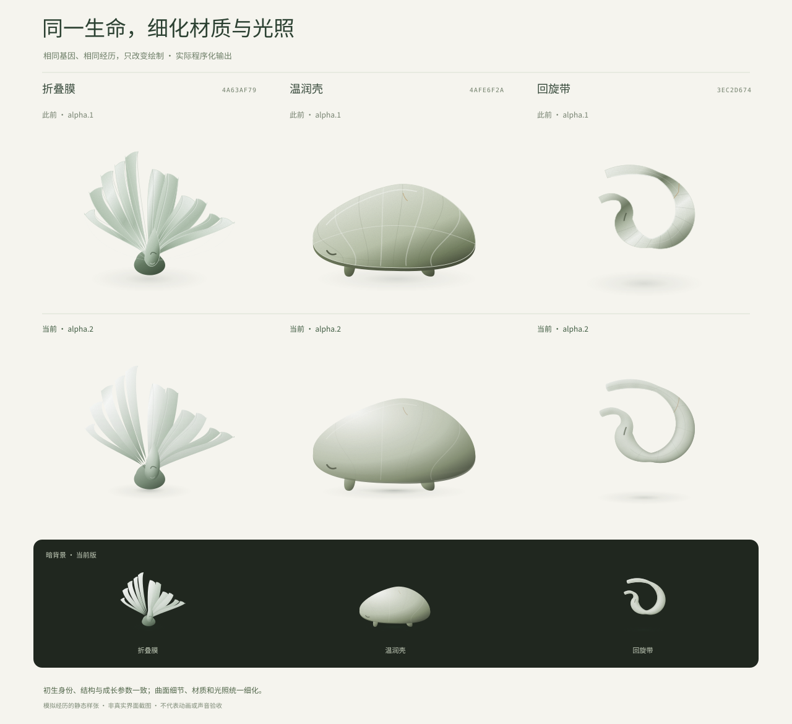

# dsh-music

在 DeepSeek Harness 里听本地音乐，和一个逐渐长出自己模样的数字生命相处。**0.8.0-alpha.4** 为 ECHO 加入 25 骨骼的朏朏三维身体、v2 身体成长协议和可选 AI 成长决策。曲库播放、逐句歌词、歌手页、反信息茧房推荐、喜欢才入库、可选 Spotify 收藏同步和策展功能继续保留。

## ECHO 数字生命原型

每个生命从独立种子开始，拥有稳定的初生身份。当前三维身体以山海经朏朏为原型，由 25 个语义骨骼驱动躯干、四足、耳朵和白色长尾；体型、腿长、头部、耳朵、尾长与毛量可在支持范围内变化。你可以教它一个敲击招呼、留下一段共同记忆；离开或少听音乐不会扣分或退化。

旧档案经校验后迁移为包含 v2 身体的档案，生命 ID、seed、初生信息及既有事件保持不变。成长候选通过身份、参数、经历依据和版本检查后整套提交，保留接受结果、来源及上一身体；重启恢复已保存结果，不重新让模型生成历史。`fold`、`shell`、`ribbon` 继续作为 v1 规则视觉、旧历史快照及三维不可用时的回退。

声音特征来自浏览器本地 FFT 的近似分析，不是情绪诊断；特征不可用时只记有效播放时长，不累计 AI 成长所需的音频观察。「介绍一首歌」只记录主动分享，不会算作已经听过，也没有外部音乐平台自动收听接入。

生命在本机保存，可从「共同记忆 → 导出生命档案」下载 JSON；当前没有导入功能。容量、保存说明、独立预览与开发接口见 [ECHO 说明](docs/ECHO.md)。

### 成长模型与动作模型分别配置

在 Harness 配置独立的 `lifeGrowthProvider` 和 `lifeGrowthModel` 后，新增实际音频观察累计至少五分钟时可自动评估一次小幅身体成长。模型可以暂缓；结果过期、超出支持范围或保存失败时，当前身体继续保留。这两项默认留空，不会借用策展的 `curationProvider` / `curationModel`。

成长请求只发送身体参数、音频数值观察、互动类型及用于关联经历的标识和时间，**不向成长模型上传原始音频、歌名、艺人、记忆原文或 seed**。请求交给你配置的 Harness 模型服务，其部署位置由所选服务决定。

学习型运动服务是另一条链路，默认不可用，包内没有动物运动权重。可通过 `lifeMotionEndpoint` 或 `ECHO_MOTION_ENDPOINT` 指定兼容的本机服务；接入后校验身体版本、模型来源和连续姿态，再交给当前身体执行。未连接时的注视、足部 IK、尾部弹簧和音乐响应属于程序化运动基础，不称为 AI 生成动作；AI 成长决策也不代表学习型动作已经运行。

### 持续生命空间

找歌、发现、聆听和回忆位于同一个空间。默认只有生命、少量关系动作和直接音乐操作；不再用顶部导航切换首页、音乐与记忆。找歌结果在生命身旁展开，选曲后收回；发现一次提供至多三首真实本地候选。旧时间线以 v1 规则视觉回看，播放器与档案保持原状；当前尚无朏朏全部成长阶段的三维回放界面。

点击当前曲目可展开进度、音量、喜欢、不喜欢和歌词。曲库管理、联网发现、策展、历史等复杂功能从「空间工具」打开，仍保留原有业务界面；关闭工具后回到同一空间。

### 生命与桌面伴生

当前朏朏使用三维骨骼与蒙皮身体，主空间和伴生共用同一身体档案。身体成长时，网格、骨骼、绑定与接触控制随统一描述更新；当前只支持同一身体结构内的比例变化，不支持任意新增肢体。

离开音乐面板后，完整生命出现在 Harness 应用内。默认只有脚边的播放、下一首和「音乐」入口；触碰身体打招呼，点击身体印记回看真实记忆。明确打开「音乐」后，可操作喜欢、不喜欢、歌词以及更多播放控制。歌词默认关闭，开启后显示独立的当前句。收拢、返回主舞台与隐藏位于「音乐 → 更多」；隐藏不停止播放。

下图保留 alpha.1 / alpha.2 的 `fold`、`shell`、`ribbon` 材质对照，属于 **v1 规则视觉样张**，不代表当前朏朏或学习型运动效果。



## 音乐工作台

从「空间工具 → 策展」可使用智能歌单、私人电台、音乐时光机、音乐考古、每日盲盒。`⌘K` 或 `Ctrl+K` 聚焦空间中的本地搜索；`/playlist`、`/radio`、`/history`、`/find`、`/daily` 保留在「空间工具 → 音乐指令」。策展使用本地曲库、媒体标签、喜欢及收听记录。歌单存于当前前端，删除歌单不影响歌曲文件。

本机可选择使用 Harness 中已配置的模型来理解输入指令。配置 `curationProvider` 与 `curationModel` 后，策展台会显示可选开关。模型只收到输入的指令。

## 功能

- **曲库**：扫描 `~/Music/dsh-music`、`~/Music/spotify-liked`、`~/Music/Music/Media.localized`（m4a/opus/mp3/flac/wav），读内嵌标题/歌手/专辑/时长/封面；支持搜索、按歌手专辑分组、三态曲库视图。
- **播放**：播放/暂停、上下首、拖动进度（HTTP Range）、音量、单曲/顺序/随机、队列；跨面板音灵伴生窗控制同一队列，可收拢身体、拖动和隐藏（仅在 DSH 应用内）。
- **歌词与歌手**：内嵌 → LRCLIB → 网页兜底；歌手简介/动态/逸闻/相似歌手，均注明来源与日期。
- **推荐**：基于收听历史的传统算法（零 LLM），今日/同歌手/新风格三栏，探索轴轮换避免信息茧房；推荐候选先经 MusicBrainz 核实再下载。
- **喜欢才入库**：在线试听一律为临时缓存（不入库、不改曲库）；点 ♥ 才下载到 `~/Music/dsh-music/` 并入库。Spotify 取消收藏不会删除本地文件。
- **音乐来源引导（保留原功能）**：原创蓝色大肥鱼 Logo、口味多选（流派/语言）、曲库选择（用已有曲库 / 默认 starter 曲库）；口味作为推荐软偏置（命中优先、不锁死）。
- **默认 starter 曲库（0.3）**：4 首公有领域（Public domain）古典录音，逐首经 Wikimedia Commons 元数据复核许可后串行下载为 128k AAC，署名（来源 URL / 许可 / 作者）随曲目留档；网络失败自动跳过，不阻塞进入推荐。
- **社区（0.3 设计稿）**：opt-in、无自建后端、不上传本地数据；分享卡片与分享码歌单方案见仓库 `docs/community-design.md`。

## 安装

插件品牌名是 **dsh-music**，npm 包名是 **`@vicyangorg/dsh-music`**（原名 `dsh-music` 被 2026-08-19 的占位包占用；GitHub 仓库仍是 vicyangworld/dsh-music）。client 工厂 id 与包名一致，安装后插件行/面板照常出现。

1. 安装插件包：在 DSH 插件市场安装，或用 `plugin_manager` 安装本包（目录、`.tgz` 或 `link:` 源码目录）。
   ```text
   plugin_manager(install_bundle, target: "link:/绝对路径/dsh-music/bundle")
   ```
   也支持本地构建的 tgz：`target: "/path/to/vicyangorg-dsh-music-0.8.0-alpha.4.tgz"`。本 README 不代表该 alpha 已在插件市场或 npm 发布。
2. 刷新 DSH 页面，左侧栏出现「音乐」面板图标，点开即用。
3. 可选：安装 `yt-dlp` 与 `ffmpeg`（macOS: `brew install yt-dlp ffmpeg`），用于在线试听与「喜欢才入库」；不装也能播放本地曲库。

从源码工作时，先在仓库根目录执行 `npm ci` 和 `npm run build`，再安装 `bundle/`。前端源码位于 `src/client/`；`bundle/client/index.js` 是生成文件，修改源码后需要重新构建，再刷新或重新启用插件。Harness 提供 React，插件产物不捆绑第二份 React。

### 独立预览

在完整源码仓库的根目录执行以下命令；仅下载 npm 插件包时不包含这些开发脚本。

```bash
npm ci
npm run build
npm run preview
```

访问 `http://127.0.0.1:4173`。预览只提供三段原创合成试听，不扫描用户曲库、不连接音乐平台，也没有 Harness 成长模型；仅在显式设置 `ECHO_MOTION_ENDPOINT` 时连接本机运动服务。预览使用独立数据目录，终端会显示具体路径；可用 `npm run preview -- --data-dir /绝对路径/echo-preview-data` 指定专用目录。

## 快速开始

1. 打开左侧栏「音乐」与音灵见面；点「找音乐」选择已有曲目，或从「空间工具 → 音乐来源」选口味、选曲库。
2. 曲库为空时，打开「在线发现」搜索歌手或歌名；在线结果可试听，使用临时缓存、不入库。
3. 点击空间中的当前曲目，操作进度、音量、模式、喜欢和不喜欢。喜欢在线歌曲后沿用原有核实与入库逻辑。
4. 点「共同记忆」回看成长或导出档案。离开主空间后，伴生窗通过「音乐 → 更多」调整进度、音量、队列，或收拢和隐藏；隐藏后从「空间工具 → 显示伴生窗」恢复。

## 可选依赖

- `yt-dlp` + `ffmpeg`：在线试听、喜欢入库的下载音源（上限 YT Music ~128k AAC；不引入盗版音源）。
- `spotify-sync` CLI：一键同步 Spotify 收藏（检测不到时按钮置灰，不影响其他功能；插件只调用 CLI，不接触凭据文件）。

## 数据位置

- 收听历史、缓存、喜欢、推荐记录、onboarding 状态：`~/.dsh/dsh-music/`
- ECHO 生命档案：`~/.dsh/dsh-music/echo-life.json`；配置 `dataDir` 时使用对应目录。包含原有生命与事件、v2 身体和已接受成长结果及来源；保存后可导出，目前不提供导入。
- 喜欢入库与 starter 曲目：`~/Music/dsh-music/`
- 默认扫描曲库：`~/Music/dsh-music`、`~/Music/spotify-liked`、`~/Music/Music/Media.localized`（欢迎页可追加自定义目录，配置 `directories` 也可自定义）

## 隐私与已知限制

- 无产品遥测、无账户后端。在线请求用于搜索、歌手页、歌词兜底、推荐核实、下载，以及分别配置的模型辅助策展和 AI 成长。策展只向模型发送输入指令；成长只发送数值观察、互动类型和身体参数等必要条件，不发送原音频、歌名、艺人、记忆原文或 seed。可选本机运动服务处理骨架、姿态、目标和数值条件。
- 默认未配置 AI 成长，学习型运动服务也默认不可用。参数化身体及程序化动作不是无限物种生成或开放式学习；AnyTop 等研究采样不等于本版已经接通实时模型。用户设备上的 Harness、真实音频与动画性能仍需验收。
- 当前伴生窗位于 DSH 应用内。跨应用置顶、系统桌面独立窗口与点击穿透尚未实现。
- 在线试听缓存有上限（LRU 30 首），清空不影响曲库。
- ECHO 原型最多保存 100,000 条已接受事件、64 段共同记忆、96 个 v1 时间线节点和 10,000 次身体成长记录；存档最大 64 MiB。旧的普通时间线节点会精简，初生节点与共同记忆保留；去重标识不会过期。达到相应容量上限后拒绝新增写入，已有档案仍可查看、导出。

## 维护者发布

打包、GitHub Release 与 awesome 列表 PR 步骤见仓库 [`docs/publishing.md`](https://github.com/vicyangworld/dsh-music/blob/main/docs/publishing.md)。

## 更多

完整功能说明、隐私与已知限制见 [docs/DETAIL.md](docs/DETAIL.md)。
