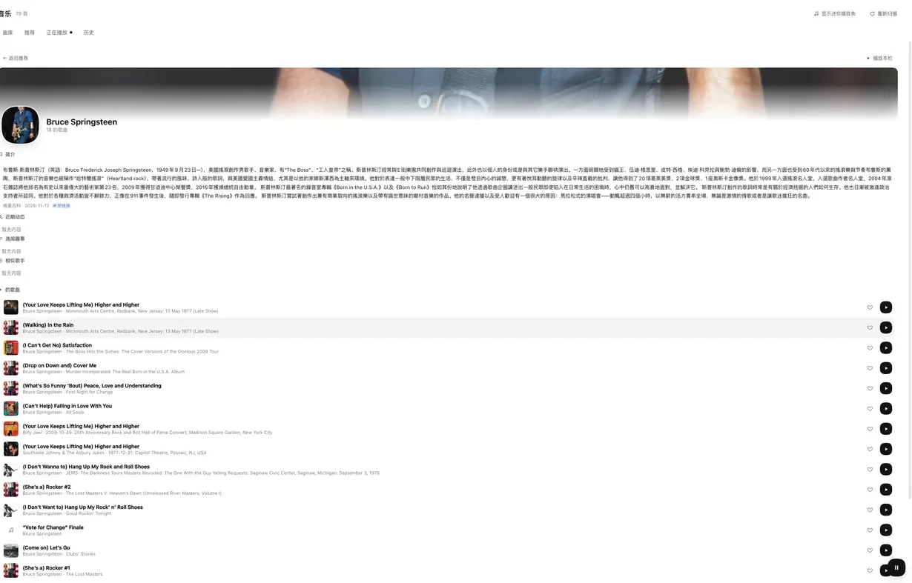

# ECHO 音灵（dsh-music）

在 DeepSeek Harness Desktop（DSH）里，让共同聆听的音乐慢慢改变一个数字生命。
**0.8.0-alpha.4 加入 25 骨骼的朏朏三维身体与 v2 身体成长。** 找歌、选歌、聆听和回忆围绕同一个生命展开；初生身份、招呼、记忆和本机档案保留。可独立配置 AI 成长决策，学习型运动服务默认不可用。无框伴生及曲库、歌词、策展与联网推荐继续保留。完整原型边界见 [ECHO 说明](ECHO.md)。

以下两张保留的样张属于 `fold`、`shell`、`ribbon` 的 **v1 规则视觉**，不代表当前朏朏三维身体或 AI 运动效果。


以下音乐功能截图来自此前版本，用于说明保留的能力，不代表本版音灵主舞台的视觉。


---

## 三步上手

**第 1 步 · 安装**
在 DSH 里用插件管理器安装本包（bundle 形式）：

```
plugin_manager install_bundle  target=link:/绝对路径/dsh-music/bundle
```

看到返回 `application: applied` 即安装成功。刷新当前页面，左侧栏就会出现 **「音乐」** 入口。

**第 2 步 · 打开**
点左侧栏「音乐」与音灵见面。它会一直留在这个空间；点「找音乐」搜索曲库，点「共同记忆」回看成长。从右上角「空间工具 → 音乐来源」打开原有曲库引导：

- 选口味：流派 / 语言多选，可以跳过；
- 选曲库：用你自己已有的曲库，或选「默认 starter 曲库」——串行下载 4 首公有领域古典录音（128k AAC，来源 / 许可 / 作者留档本机），网络失败会逐首跳过，不阻塞进入推荐。

如果你电脑里已有音乐，它会自动扫描这三个目录：

`~/Music/dsh-music/` · `~/Music/spotify-liked/` · `~/Music/Music/Media.localized/`

没扫到可以在「空间工具 → 管理曲库」中点「重新扫描」；想用别的目录，可在插件配置里用 `directories` 自定义。

**第 3 步 · 开始听**
- **有本地音乐**：点「找音乐」，搜索或直接选择一首；选中后搜索收回，开始一起听。
- **没有本地音乐也能听**：打开「在线发现」，输入歌手、歌名或风格 → 从联网结果里点「试听」（临时缓存，不进曲库）→ 觉得好听就点 ♥，它才会下载入库。
- 所有播放入口统一是**试听语义**（「播放 / 试听 / 播放该列表」都不会自动下载或入库），只有 ♥ 才下载入库。

> 喜欢才入库：**播放 = 试听（不入库）**，**♥ = 收藏并下载入库**。取消 ♥ 不会删掉已下载的文件，删不删由你决定。

---

## 界面导览

### 朏朏的身体与成长

当前三维身体以山海经朏朏为原型，25 个语义骨骼共同驱动躯干、四足、耳朵与白色长尾。体型、腿长、头部、耳朵、尾长和毛量可以在支持范围内变化；同一身体描述同步提供网格、骨骼、绑定、接地点、触摸区域与运动条件。当前只支持这一身体结构内的比例变化，不支持任意新增肢体或无限生成物种。

旧档案先校验再迁移，保留生命 ID、seed、初生信息与既有事件。v2 成长提案必须通过身份、参数、经历依据和版本检查，随后整套保存；推理期间出现新经历会使旧提案失效，保存失败继续使用上一完整身体。接受的成长结果、模型来源和上一身体记录保存在本机，重启恢复原结果，不重新生成历史。

| 能力 | 配置 | 默认行为 |
|---|---|---|
| AI 身体成长决策 | 独立设置 `lifeGrowthProvider` 与 `lifeGrowthModel`，对应 Harness 已注册的实际模型 | 未配置，不请求模型；保留当前身体和经历 |
| 学习型运动生成 | `lifeMotionEndpoint` 或 `ECHO_MOTION_ENDPOINT` 指向兼容的本机服务 | 不可用，包内不附带动物运动权重 |
| 本地运动基础 | 无需模型配置 | 使用程序化注视、足部 IK、尾部弹簧和音乐能量响应，不称为学习型 AI |
| 可选模型辅助策展 | `curationProvider` 与 `curationModel`，并在策展台主动启用 | 本地规则选曲；不会自动用于身体成长 |

成长模型配置完成后，新增实际音频观察累计至少五分钟时可自动评估一次小幅变化。模型可以暂缓，不保证每五分钟成长一次。未配置时，普通播放事件不会直接改写当前朏朏身体；有效播放、近似声音特征和互动仍会记录。没有音频特征时只记有效播放时长，不累计这次成长所需的音频观察。

AI 成长决策与 AI 动作生成是独立能力。运动服务只有返回匹配当前身体、带模型来源信息且通过连续性检查的姿态序列，才会参与实时执行。研究模型的离线采样不代表产品已经接通实时运动链路。

### 一个持续存在的生命空间

默认画面以生命、光线和留白为主，没有顶部页面导航。点击名字可命名，轻触身体可互动，也能教它一个节奏招呼、留下带身体印记的共同记忆。「共同记忆」在它身旁展开；旧时间线以 v1 规则形态回看，回到现在后恢复当前身体，播放不受影响。当前尚无朏朏全部成长阶段的三维回放界面。

「找音乐」与 `⌘K` / `Ctrl+K` 搜索实际本地曲库；「帮我挑几首」一次展开至多三首可播放候选，来自喜欢记录与本地曲库。选曲后内容收回，生命和播放器保持同一实例。点击当前曲目可展开进度、音量、播放模式、偏好与歌词；歌词默认关闭，开启后在稳定位置显示当前句。

「空间工具」保留曲库管理、联网发现、策展、历史、歌手资料、来源设置等复杂能力。它们继续使用原有业务界面，按需打开并明确返回；这部分尚未完成空间视觉重构。实际本地播放的可用声音特征可作为 AI 成长依据；主动介绍歌曲只记录分享，不会冒充已经听过。

### 无框伴生

离开音乐面板后，生命在 Harness 应用内继续陪伴。默认画面显示完整身体，脚边保留播放、下一首和「音乐」入口。触碰身体用于招呼，身体上的记忆标记打开独立纸条；这些动作不切歌，也不会自动展开音乐工具。

点击「音乐」可看到当前歌曲、播放控制、喜欢、不喜欢与歌词开关。「更多」中提供进度、音量、静音、播放模式、队列，以及收拢、返回主舞台和隐藏操作。音乐工具明确关闭后恢复默认画面。歌词默认关闭，开启后以独立当前句显示，并记住选择。

不喜欢保存成功后会跳到队列中的另一首可用歌曲，没有候选时暂停；可以撤销，恢复之前的偏好并保持当前播放。喜欢在线歌曲时沿用核实后入库的逻辑，缺少核实时仅保存喜欢。保存失败会显示原因。

### 音乐策展台

从「空间工具 → 策展」打开音乐策展台。用一句话筛选本地歌曲并保存歌单，也可按场景生成电台队列、重听近期曲目、探索当前歌曲的相关曲目或打开每日盲盒。原有斜杠指令保留在「空间工具 → 音乐指令」。所有工具和生命空间共享同一个播放器。

### 曲库管理工具

从「空间工具 → 管理曲库」打开。
工具栏从左到右：搜索框 · 分组方式（列表/按歌手/按专辑）· 播放全部 · 播放模式（单个按钮循环切换：顺序 → 随机 → 单曲）· Spotify 同步（可选）· 重新扫描。
行尾有 ♥ 与「…」菜单（在文件管理器中显示 / 删除本地文件）。


### 在线发现工具

从找歌空间或「空间工具 → 在线发现」打开。这里保留完整的联网搜索与推荐，和生命身旁的三首本地候选分别使用。
三栏并排：**今日推荐 / 歌手推荐 / 新歌推荐**。新用户还没听够 3 首时，今日栏会显示「探索批次」说明条（公众热门流派/场景的探索曲，≥6 首）。
- 歌曲行带封面、推荐理由、播放按钮与 ♥；歌手栏是列表行，带真实歌手照片，点整行进歌手页。
- 顶部还能用一句话描述风格，例如「深夜爵士」「80s rock」，会映射成流派标签去找歌（传统算法，不依赖大模型）。
- 欢迎页选的口味（流派 / 语言）作为**软偏置**：命中的优先出现，但不会锁死推荐，探索位照常保留。

### 历史与统计
- 六张统计卡：播放次数 / 总时长 / 歌曲数 / 歌手数 / 跳过次数 / 平均完整度。
- 近 7 天播放趋势（纯本地计算）、常听歌曲 Top10、常听歌手 Top10；常听歌曲列表也支持「播放该列表」（按当前播放模式入队，随机态会打乱）。
- 收听记录按日期分组，每行有封面、完整度徽章、是否跳过、播放时间；顶部有「播放该列表」。

### 歌手页
点支持的歌手入口（曲库行、历史行、正在播放、搜索里的歌手 chip）都进入**同一个歌手页**：横幅头图 + 圆形头像 + 简介（注明来源与日期）+ 歌曲列表（可播、可 ♥）。



---

## 功能一览

| 想做的事 | 怎么做 |
|---|---|
| 听本地音乐 | 「找音乐」选择曲目；支持 m4a / mp3 / flac / wav / opus |
| 只想听某首没下载的歌 | 「在线发现」搜索 → 试听（临时缓存，不入库） |
| 收藏并长期保留 | 点 ♥ → 自动下载入库到 `~/Music/dsh-music/` |
| 边听边看歌词 | 点击当前曲目 →「显示歌词」；「完整歌词与队列」保留逐句同步高亮；无歌词时显示实际状态 |
| 了解歌手 | 点任意歌手名进歌手页；资料逐条注明来源与日期，区分事实与传闻 |
| 换口味找歌 | 「在线发现」三栏；或输入一句风格描述搜索 |
| 播放模式 | 点击当前曲目后切换顺序 / 随机 / 单曲循环；管理工具内的「播放全部」跟随当前模式 |
| 批量播放 | 任何列表（曲库、搜索、推荐每栏、歌手页、历史、历史页常听歌曲）都有「播放该列表」；点任何单曲会入队并立刻切到这首 |
| 音灵伴生窗 | 离开主面板后显示完整生命；触碰用于招呼，身体印记回看记忆。脚边控制播放与下一首；「音乐」展开偏好与歌词，「更多」操作进度、音量、队列、收拢、主舞台和隐藏。可拖动、用方向键移动并记住位置；隐藏后从「空间工具 → 显示伴生窗」恢复。 |
| 音乐来源设置 | 从「空间工具 → 音乐来源」打开引导，选口味 / 选曲库；选「默认 starter 曲库」会串行下载 4 首公有领域古典录音（署名留档，失败自动跳过） |
| 管理文件 | 行尾「…」→ 在文件管理器中显示 / 删除本地文件（Spotify 收藏曲需二次确认；Apple Music 曲目请在 Apple Music 中管理） |
| 同步 Spotify 收藏 | 曲库工具栏「同步 Spotify」（**可选功能**，见下） |
| 看听歌统计 | 历史页顶部六张卡 + 趋势 + Top 榜 |
| 搜索 | 空间中的「找音乐」查询本地歌名 / 歌手 / 专辑；管理工具保留简繁搜索与联网补全，联网歌手结果可打开资料 |

---

## 隐私与数据

**生命档案、共同记忆和本地收听记录保存在本机。** 保留的 v1 规则本身不调用模型；alpha.4 的 AI 成长是独立可选模块，不再适用“所有成长都不调用模型”的旧说明。

配置 `lifeGrowthProvider` 与 `lifeGrowthModel` 后，成长请求交给所选 Harness 模型服务，发送身体参数、音频数值观察、互动类型，以及关联经历的标识和时间。**不会向成长模型上传原始音频、歌名、艺人、记忆原文或 seed。** 模型在本机还是云端运行，取决于所选服务；未配置时不会请求成长模型。

可选本机运动服务接收身体骨架、当前姿态、交互目标、数值音乐条件和动作风格参数。音乐检索、歌词、封面和推荐仍使用下列内容接口；配置并主动启用模型辅助策展后，策展输入指令会另行交给所选模型解释。策展与成长使用不同配置。

| 数据 | 位置 | 说明 |
|---|---|---|
| 推荐下载的歌曲 | `~/Music/dsh-music/` | 只有你点 ♥ 或手动下载才会写入 |
| starter 曲库与署名 | `~/Music/dsh-music/starter/` 与 `~/.dsh/dsh-music/starter.json` | 仅当你选「默认 starter 曲库」时写入；4 首公有领域录音的来源 URL / 许可 / 作者留档本机 |
| Spotify 收藏曲 | `~/Music/spotify-liked/` | **仅 Spotify 同步工具写入**，本插件不修改 |
| 生命档案 | `~/.dsh/dsh-music/echo-life.json` | 初始种子、原有生命与事件、记忆、v2 身体、接受的成长结果及模型来源；可导出，alpha 尚无导入界面 |
| 收听历史 | `~/.dsh/dsh-music/history.jsonl` | 只在本机 |
| 缓存 | `~/.dsh/dsh-music/cache/` | 歌词、歌手资料、封面与歌手图、推荐发现、核实留档 |
| 推荐与喜欢记录 | `~/.dsh/dsh-music/`（`reco-*.json`、`likes.json`） | 只在本机 |

- **starter 曲库**：4 首公有领域（Public domain）古典录音（肖邦 ×2、德彪西、萨蒂），来自 Wikimedia Commons，下载前逐首再核对 Commons 元数据；来源页面 / 许可（CC PD Mark 1.0）/ 演奏者署名保存在 `~/.dsh/dsh-music/starter.json`。
- **不读取任何 Spotify 凭据**：Spotify 同步是把工作交给系统里已安装的 `spotify-sync` 命令行工具，凭据由它自己管理，本插件从不读取。
- 试听缓存存在 `~/.dsh/dsh-music/cache/preview/`，最多保留最近 30 个，不会进曲库。
- 音乐内容的联网请求使用以下来源；可选模型请求的数据范围另见上文：
  - **MusicBrainz**：核实歌曲真实存在（每首推荐都带核实链接）
  - **维基百科 / Wikimedia Commons**：歌手简介、歌手照片、starter 曲库录音（仅首次 onboarding 选择时）
  - **iTunes 搜索**：专辑封面
  - **LRCLIB**：歌词
  - **YouTube**：试听 / 下载音源（上限 YT Music 约 128k AAC）

---

## 可选依赖

| 依赖 | 用途 | 没有会怎样 |
|---|---|---|
| `spotify-sync` CLI | Spotify 一键同步 | **可选**。按钮会置灰并提示「未检测到 spotify-sync CLI，可跳过，不影响听歌」 |
| `yt-dlp` + `ffmpeg` | 联网试听、下载歌曲、读取本地标签 | 试听/下载不可用，会给出中文安装指引（macOS：`brew install yt-dlp ffmpeg`）；本地播放与搜索不受影响 |
| 网络 | 核实、歌词、歌手资料、封面 | 离线时本地曲库照常播放，联网内容会提示失败原因 |
| 已配置的 Harness 成长模型 | 对新的真实音频观察与互动提出身体变化 | 默认未配置；身体和经历保留，不影响本地播放与程序化互动 |
| 兼容的本机学习型运动服务 | 根据当前身体、姿态与目标生成连续运动 | 默认不可用；插件不附带权重，继续使用明确标注的程序化运动基础 |

> 二进制的定位顺序：插件配置里指定的路径 → 系统 `PATH` 自动探测 → 都找不到则提示安装命令。不会写死任何人的电脑路径。

---

## 已知限制

- 当前可生长三维身体只支持朏朏这一固定骨架与有界比例；音频特征是本地 FFT 近似值，不用于情绪诊断，也不保证任何两个个体都永远肉眼可区分。
- AI 成长默认未配置，学习型运动服务默认不可用。当前没有开放式人格学习、任意新增肢体或自动读取其他音乐应用播放状态的能力；AnyTop 等研究采样不等于产品已接入实时模型。
- 档案最多保存 100,000 条已接受事件、64 段共同记忆、96 个 v1 时间线节点和 10,000 次身体成长记录，最大 64 MiB。达到相应上限会拒绝新增写入，已保存内容仍可查看和导出。
- alpha.4 尚未完成用户设备上的 Harness、真实音频输出和动画性能验收；没有档案导入界面或跨设备自动同步。
- 音源上限 **YT Music ~128k AAC**；不接入任何盗版或非官方音源。
- 伴生窗当前位于 **DSH 应用内**，跨应用置顶、系统桌面独立窗口与点击穿透尚未实现。
- 少量冷门曲目在公开源没有封面、或时长与 MusicBrainz 记录略有出入（软警告，仍可播放）；没有图时会用音符占位，不会裂图。
- 推荐的多样性依赖你的曲库与收听规模。**收听不足 3 首时，今日推荐是「探索批次」**：基于公众热门流派与场景生成，至少 6 首起步、逐首联网核实，带说明文案；听满 3 首后自动切回按口味排的「相近 + 探索」批次。
- 推荐与统计都是传统算法 + MusicBrainz 发现，**不使用任何大模型**。
- Spotify 取消收藏**不会**自动删本地文件，是否删除由你决定。
- 在文件管理器中显示：macOS / Windows / Linux 均已适配；其他桌面环境可能只能拿到文件路径。
- 主要开发与验证环境是 macOS，Windows / Linux 未做实机全流程验证。

## 常见问题

**Q：曲库是空的，能用吗？**
能。搜歌手或歌名 → 试听；喜欢就点 ♥ 下载入库。也可以把音乐放进上面三个扫描目录后点「重新扫描」。

**Q：点试听提示缺少 yt-dlp / ffmpeg？**
按提示安装即可（macOS：`brew install yt-dlp ffmpeg`），或把可执行文件路径写进插件配置。安装后重启 DSH 或重新打开面板。

**Q：同步按钮是灰的？**
说明本机没检测到 `spotify-sync`。这是可选功能，不影响本地播放、搜索、试听与推荐。

**Q：推荐页显示「探索批次」是什么意思？**
说明你还没听够 3 首歌。这时插件先从公众热门流派/语言/年代/场景里挑 ≥6 首探索曲（每首都联网核实过），帮你打破信息茧房；听满 3 首后会自动切回按你口味排的推荐。

**Q：我的数据会传到哪？**
生命档案、共同记忆与本地收听记录保存在本机。搜索、歌词、推荐核实与下载会请求相应内容服务；主动启用模型辅助策展时，输入指令交给策展模型。另行配置成长模型后，它会收到身体参数、数值观察和互动记录等必要条件，不收到原始音频、歌名、艺人、记忆原文或 seed。具体来源见「隐私与数据」。

**Q：换电脑怎么带走？**
复制 `~/Music/dsh-music/`（下载的歌）和 `~/.dsh/dsh-music/`（历史与缓存）到新机器同位置即可。

## 社区（设计稿，本期不实现）

- **opt-in、零主动上传**：每个分享动作都由你显式点击、先预览全文；插件不会替你发布任何内容，也没有默认开启的分享。
- **无自建后端、无账号、无遥测**：分享卡片/分享码由你自行保存或粘贴到任意社区；收听历史、本地路径、曲库规模、凭据永远不会随分享离开本机。
- 方案细节（分享卡片、分享码歌单、GitHub Discussions 广场）见仓库 `docs/community-design.md`；实现留待后续版本。

## 卸载

```
plugin_manager remove_bundle  target=@vicyangorg/dsh-music
```

卸载不会自动删你的文件。想清理数据，手动删除 `~/Music/dsh-music/` 与 `~/.dsh/dsh-music/`；
`~/Music/spotify-liked/` 里是 Spotify 的收藏文件，是否保留由你决定。

---

*兼容性：需要 DSH 0.2.2-rc.2 及以上（插件清单 `engines.dsh` 声明）。截图取自开发版界面，实际以你的 DSH 主题（明/暗）为准。*
