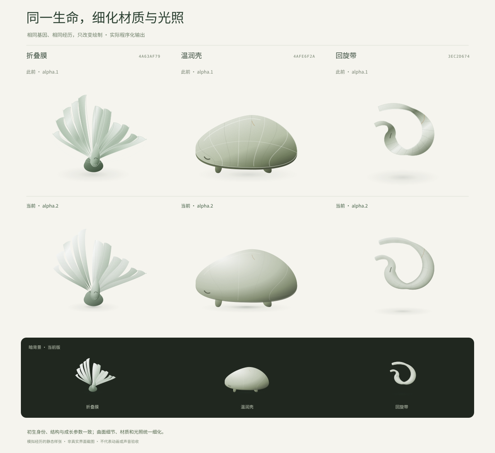

# ECHO · 0.8.0-alpha.4 原型说明

ECHO 为 dsh-music 加入一个与本地音乐共同成长的数字生命。它继承 0.7.0 本地改版的曲库、播放、歌词、推荐与策展能力，再加入稳定的生命身份、声音驱动的形态变化、敲击招呼、共同记忆与形态回看。

当前版本是可以本地运行的 alpha。本文描述已实现的规则与接口，不代表已经发布到 npm、安装到你的设备，或完成所有浏览器和 Harness 版本的兼容性验证。

## alpha.4：可生长身体与模型接口

本版接入朏朏三维身体原型。主空间与伴生视图读取同一个身体版本；历史 v1 形态、旧宿主和不支持 WebGL 的环境保留 SVG 回退。当前形体是工程样机，尚未完成最终毛发、表情和动画美术。

| 能力 | 实际状态 |
| --- | --- |
| 身体协议 | 保留生命 ID、种子、出生时间和经历。新增独立身体 schema v2，原生命规则仍为 v1。 |
| 参数化身体 | 25 个语义关节、4 个接地点、蒙皮躯干和尾巴、身体比例、碰撞/触摸区域与运动条件。当前只支持朏朏结构。 |
| 连续成长 | 骨架、绑定和形体一起变化，保留运动状态与接地，约 1.8 秒渐变。该时长是实现参数，不是实机性能结论。 |
| AI 成长 | 已接入可选 Harness 模型，生成带经历依据与模型来源的小幅身体提案；默认未配置。 |
| 学习型动作 | 已实现姿态轨迹协议、版本/来源/连续性校验及执行入口。包内没有动物运动权重，默认 unavailable。 |
| 本地动作 | 视线、足部 IK、尾部弹簧与音乐能量响应属于程序化基础，不称为学习型 AI。没有预制动画选择器。 |
| 持久化 | 接受的 AI 结果整体保存，重启恢复相同结果，不重新向模型生成历史。 |

### 配置与数据边界

在 Harness 的 dsh-music 宿主配置中设置实际可用的 `lifeGrowthProvider` 和 `lifeGrowthModel`，必须对应已注册的模型服务。未配置时不请求模型，也不会从策展配置中暗中借用。

成长模型接收身体参数、允许范围、有限的数值音频观察和互动类型；不发送原始音频、歌名、音乐路径、记忆正文或出生种子。每次接受成长后，至少再累计五分钟具有实际特征的音频观察才具备下一次评估资格。模型可以返回暂缓；五分钟是调用门槛，不是必然成长的开关。这是身体提案模型，尚未实现每用户在线训练。

`lifeMotionEndpoint` 或宿主环境变量 `ECHO_MOTION_ENDPOINT` 可以指定符合协议的本机学习型运动服务，例如 `http://127.0.0.1:8765`；示例端口不代表已有服务。只接受明确的回环 IP 与端口，不接受外网地址、凭证、路径或重定向。

完整运动协议与研究边界见 [运动模型说明](ECHO_MOTION.md)。只有实际返回的连续关节轨迹通过验证并进入执行，运行状态才标记为 learned。模型清单中的能力声明本身不能证明质量或实时性。

### 成长一致性

候选身体先完整构建和验证，再原子提交。提案基于 `baseLifeRevision` 与 `baseBodyRevision`；生成期间新增经历或身体改变会使旧提案失效。所有已接受结果保存 ID、模型来源、原因和经历依据。重新加载会验证身体重建结果、成长顺序与提案当时的实际音频累计量。

v1 档案先通过原校验，再迁移到档案 v2。写入失败保留原文件。当前保留上一身体快照，但没有用户可操作的回滚界面；旧版程序会拒绝读取 v2 档案。历史 SVG 快照继续按原规则解释，形态示例页仍是明确标记的旧版规则研究。

新增接口：

- `GET /dsh-music/api/life` 在原字段外返回 `body`、最近成长记录与评估资格。
- `GET /dsh-music/api/life/development` 返回成长模型连接状态。
- `POST /dsh-music/api/life/development` 由当前本机同源客户端请求基于当前版本的成长。
- `GET /dsh-music/api/life/motion` 返回学习型运动服务状态。
- `POST /dsh-music/api/life/motion/generate` 请求当前身体、姿态、目标与音乐条件下的新运动。

## 一个持续存在的生命空间

alpha.3 重做主体验的信息架构。打开插件后进入同一个生命空间；找歌、共同聆听、发现和回看经历只改变周围出现的内容，不再由顶部导航切换整页。生命本体和播放器持续存在。

| 行为 | 空间中的变化 |
| --- | --- |
| 找音乐 | 搜索在生命身旁展开，直接查询实际本地曲库；选择歌曲后收回结果，开始共同聆听。`⌘K` / `Ctrl+K` 聚焦这一入口。 |
| 换一种声音 | 从实际本地曲库或已喜欢的本地歌曲中挑选少量候选；不编造推荐理由，也不把本地筛选描述为联网 AI 推荐。 |
| 正在听 | 当前曲目与直接播放操作留在空间中；进度、音量、歌词和偏好在需要时展开。 |
| 回看经历 | 同一个位置上的身体呈现所选历史形态；回到现在恢复当前身体，播放状态不受影响。 |
| 身体与记忆 | 轻触身体回应，印记打开真实记忆；命名、教招呼和留下记忆沿用同一份本机档案。 |
| 音乐工具 | 目录管理、联网搜索与推荐、策展、完整歌词与队列、历史统计、歌手资料和来源设置按需打开，关闭后回到同一空间。 |

高频路径使用重新组织的空间交互；复杂管理工具继续保留原有业务能力。工具存在并不意味着所有功能都已改为同一种新视觉。这里也尚未加入自由对话、自动理解任意自然语言意图或跨应用原生窗口。

`npm run habitat-demo` 从实际 `EchoHabitat` 组件生成会话交互演示。演示使用明确标注的示例生命、模拟成长记录与本地内存中的曲目状态，不输出音频、不连接用户曲库、不写入正式生命档案。正式插件和独立预览仍接入现有的真实播放器及服务。

## 保留的 v1 视觉与回退

以下规则针对保留的 v1 SVG、历史快照与回退，不能代替 alpha.4 朏朏的新物种美术方向。桌面伴生默认显示完整身体，音乐工具通过明确入口展开。

### 统一品质，保留个体

| 层次 | 设计规则 | 验收方式 |
| --- | --- | --- |
| 轮廓 | 保留种子决定的结构、比例与不对称；身体有主次和重心。 | 去掉文字与颜色仍可辨认形体；在常用伴生尺寸检查开口、肢体和边缘是否清楚。 |
| 材质 | 使用低饱和矿物色、温润哑光内核与轻薄柔膜；微纹理只在靠近观察时显现。 | 先看体积，再看细节；颗粒和纹路不能成为小尺寸下的第一视觉。 |
| 光照 | 使用统一的柔和主光、局部明暗与接触阴影；高光服从曲面变化。 | 深浅背景都能辨认轮廓；不能依赖一圈统一的白描边维持可见性。 |
| 表面细节 | 膜片内部线条裁剪在膜片内；壳面纹理稀疏；带状边缘保持平顺。 | 不出现游离线、密集网格或小尺寸锯齿；同一基因在不同显示尺寸保持可辨认。 |
| 动作 | 静息轻缓、注意力有限转向、招呼有结束；播放状态影响姿态和活动程度。 | 控件不随身体动画移动；暂停后生命仍可回应；减少动态效果时信息与操作完整。 |
| 记忆 | 真实共同记忆形成克制的身体标记，入口与音乐偏好分开。 | 查看记忆不切歌、不同时触碰身体；收拢姿态中标记仍与身体正确对应。 |

旧版个体差异来自已有基因、声音经历、招呼和记忆。alpha.4 保留这些规则和经历，增加独立身体协议与明确的档案迁移。材质与光照遵循统一的艺术方向，避免让每次随机生成都重新定义审美标准。

旧版回退使用 SVG 与 CSS 表达曲面和明暗，新身体使用三维骨架。播放时的动作也不宣称与真实节拍精确同步。真实音频特征继续用于长期成长；更细的即时音乐响应需要单独接入和实机验证。

### 无框伴生的交互

默认画面由完整生命和脚边的播放、下一首、音乐入口组成。靠近、聚焦和触碰身体不会打开音乐工具；触碰用于招呼，身体标记用于查看真实记忆。音乐入口显式打开控件，关闭后恢复生命主体。

歌词默认关闭，开启后显示独立、稳定的当前句；纯文本、暂无歌词与临时试听有各自的回退。用户选择会保存。播放操作复用主界面的同一个播放器；隐藏伴生窗继续播放。

歌曲偏好与生命互动分开。喜欢保留原有的条件入库逻辑，并显示偏好保存与下载结果；不喜欢并跳过可以撤销，撤销恢复操作前偏好，不强制切回旧曲。记录失败应给出真实反馈，不能仅改变按钮外观。

这里的伴生仍是 Harness 应用内的覆盖层。跨应用置顶、系统桌面独立窗口、点击穿透等原生能力尚未实现。

### 视觉评审的依据与边界

保留的 v1 材质设计参考 [Filament 的材质与光照说明](https://google.github.io/filament/Filament.html) 中基色、粗糙度与反射分工的思路，以 SVG 近似表达，不声称实现其 PBR 模型。动作参考 [Apple 的 Motion 指南](https://developer.apple.com/design/human-interface-guidelines/motion)，使反馈简短、明确、可减少。

同一个体的改前与改后样张由实际渲染器生成，固定基因与模拟经历。初生身份、结构与成长参数保持一致，曲面细节、材质和光照的绘制经过细化。以下是程序化视觉样张，不是浏览器或 Harness 的运行截图。静态样张、DOM 检查与代码边界测试不能代替实机上的透明背景、缩放、动画和声音验收。



## 保留的 v1 经历与形态规则

初次打开生命档案时，宿主为它生成随机种子，并保存初生状态。种子决定结构语法、初始比例和对声音的响应差异；此后加载同一份档案会得到同一身份。刷新页面不会重新抽取一个生命。

旧版有三种结构语法：`fold`、`shell`、`ribbon`。这些是程序化身体的构造方式，分别支持不同的折叠、曲面与带状表达。它们不是按摇滚、爵士或电子音乐分配的职业。规则使用实际声音特征，不用歌名、歌手或流派猜测声音。

实际播放会逐步影响伸展、展开、弯曲、折叠、纹理、冷暖和浮动等连续参数。因此差异包含轮廓与比例，不只是颜色。相同种子听不同声音可以走向不同形态，不同种子听相同声音也会保留各自的初生差异；先后顺序也会影响累计结果。变化保持在有界范围内，结构身份不会在听完一首歌后突然换成另一类。

三种语法与有限的参数空间不构成「无限物种」或数学上绝不相似的承诺。当前重点是让每份本地档案具有可延续、可解释的差异；某些输入较接近时，外形也可能相近。

## 哪些经历会被记录

| 行为 | 当前记录与效果 |
| --- | --- |
| 在本插件内播放本地曲库 | 记录能够确认的实际播放时长；取得声音特征的部分参与连续形态变化。 |
| 声音分析不可用 | 记录有效播放时长，标记为无音频特征，不用歌曲标签补造声音数据。 |
| 「介绍一首歌」 | 保存主动分享事件与分享次数；不增加播放时长，也不替代真实声音输入。 |
| 教它一个敲击招呼 | 保存敲击间隔与形态快照；以后可用招呼互动回应。 |
| 触碰、招呼、休息 | 保存互动事件并产生对应交互反馈；不增加播放时长。 |
| 留下共同记忆 | 保存标题、文字及可选曲目信息，加入时间线，并为身体提供记忆标记。 |
| 命名 | 保存名字，不重新生成身份。 |
| 关闭应用、离开或少听音乐 | 不补算收听，也不扣分、不衰退。 |

暂停、静音、音量为零、拖动播放进度以及媒体未实际向前播放的区间不计入共同聆听。倍速播放按真实经过的时间计时，不通过加速获得双倍成长。采样间隔超过三秒时，原型会跳过无法可靠确认的整段间隔；因此后台强限速可能少记时长，不会把整段离开时间补算成播放。

宿主只接受当前本地曲库中能核实的曲目。外部 Spotify、Apple Music、网页播放器或系统全局音频未接入。原有 Spotify 收藏同步是独立功能，不代表 ECHO 能观察 Spotify 正在播放什么。尚未入库的在线临时试听也不作为当前的生命收听来源。

### 声音分析的边界

分析在本机浏览器中完成，使用 Web Audio 的波形与 FFT 数据近似描述能量、频谱明暗、频谱变化和纹理。这里的 `rhythm` 是频谱变化量，不能当作准确 BPM；这些数值也不能诊断你的情绪、心理状态或音乐人格。

分析失败会降级为只记录时长。播放器保留独立的直接输出路径，分析分支不负责决定是否播放音乐。保留的 v1 规则本身不调用模型；alpha.4 的 AI 成长是独立可选模块。策展模型与身体成长使用不同配置，没有自由对话功能。

变化会逐步积累。有效声音特征每累计约五分钟，时间线保存一张外形快照；这不是五分钟一次的突变开关。教招呼和保存共同记忆也会留下节点。

## 保存、导出与容量

正式插件的档案默认位于 `~/.dsh/dsh-music/echo-life.json`；配置 `dataDir` 后使用该目录下的同名文件。档案包含初生状态、已接受事件、当前状态、规则版本及内容校验值。宿主原子写入成功后才确认保存；重试同一个事件不会重复成长。

前端先暂存待发送的经历，再向本地宿主提交。界面出现待保存或失败提示时，应等待完成、重试，或使用界面提供的导出能力保留相应数据。生命档案导出包含宿主已接受的内容，不应把尚未保存的经历视为已经入档。清除浏览器站点存储可能影响待发送记录。

在生命空间打开「共同记忆」，选择「导出生命档案」可下载 JSON。**当前提供导出，没有导入界面、自动恢复流程或跨设备同步。** 导出可以留存一份可检查的档案，但不表示已经具备一键迁移能力。不要手工改写档案中的种子、数值、事件或校验值；损坏或不兼容的档案会报错并保留原文件，不会默默创建一个新生命覆盖它。

| 限制 | 当前上限与达到上限后的行为 |
| --- | --- |
| 已接受身体成长 | 10,000 次，保留完整接受结果；达到上限后保留当前身体并拒绝继续提交。 |
| 已接受事件 | 100,000 条。到达后拒绝新事件，已有状态仍可查看与导出。 |
| 档案文件 | 64 MiB。超出时拒绝本次写入，保留原档案。 |
| 共同记忆 | 64 段。达到后不能继续添加共同记忆；其他未触及容量限制的事件仍可记录。 |
| 前端待保存经历 | 正常可读状态下，待发送、隔离和当前页面暂存记录合计最多 500 条；存储读取恢复后如发现更早的队列，会分批处理，避免覆盖。 |
| 时间线 | 最多 96 个节点。保留初生与共同记忆，优先精简旧的普通聆听节点，其次是较旧的招呼节点。 |
| 可见身体记忆标记 | 使用最近 8 段共同记忆生成标记；较早的共同记忆仍在档案中。 |
| 单次播放事件 | 最多 60,000 毫秒；播放器通常每累计约 30 秒及暂停、切歌等边界提交。 |
| 名称与文字 | 名称最多 40 个字符，歌名或记忆标题最多 160 个字符，附言最多 1,000 个字符。 |
| 招呼节奏 | 2–8 个间隔，即 3–9 次敲击；每个间隔为 50–5,000 毫秒。 |

事件去重标识不会过期，也不会为腾空间删除旧标识后重新计算相同事件。时间线精简只减少回看节点，不抹掉已接受事件或改变成长结果。这是有限容量的原型；目前没有长期事件归档迁移工具。

当前并发与断线恢复以单个插件实例为边界，尚未加入多个浏览器标签页同时写同一份本机待发送队列的协调机制。

## 运行独立预览

需要完整源码仓库与 Node.js/npm；开发测试使用 Node.js 24.15+ 的 24.x，或 22.22.2+ 的 22.x。在仓库根目录执行：

```bash
npm ci
npm run build
npm run preview
```

打开 `http://127.0.0.1:4173`，点击播放后开始体验。浏览器通常要求通过点击等用户操作启动音频。

独立预览运行真实的客户端产物、成长规则与本地生命服务。曲库只有三段在本地生成的原创合成试听，不读取用户音乐目录，默认没有联网推荐、下载、Harness 成长模型或音乐平台；运动桥只有显式设置 ECHO_MOTION_ENDPOINT 才连接本机服务。界面里的「不同生命」形态示例使用明确标记的模拟声音特征，不会把模拟经历写入自己的生命档案。

默认档案目录在系统临时目录的 `dsh-music-echo-preview-<用户标识>` 子目录中，启动时会输出实际路径；该目录可能由操作系统清理。需要持续保留时，指定一个独立目录：

```bash
npm run preview -- --data-dir /绝对路径/echo-preview-data
```

也可以设置 `ECHO_PREVIEW_DATA_DIR`。不要使用正式插件的数据目录。预览为目录写入独立环境标记，并拒绝接管已有生命档案且没有预览标记的目录。端口默认是 4173，可用 `PORT=4174 npm run preview` 更改；服务仅绑定 `127.0.0.1`。

在 Harness 中安装的方式见 [包说明](../README.md#安装)。安装插件与独立预览是两个环境，不会自动交换档案。

## 源码、构建与运行时

| 位置 | 职责 |
| --- | --- |
| `src/client/index.js`、`src/client/echo/` | 前端源码、ECHO 页面、音频观察、事件提交与程序化绘制。 |
| `bundle/client/index.js` | `npm run build` 生成的浏览器单文件产物，不作为手工编辑入口。 |
| `bundle/shared/life-core.js` | 浏览器与 Node.js 共用的纯规则模块，零运行时依赖。 |
| `bundle/shared/body-core.js`、`motion-core.js` | 身体版本、成长提案与运动轨迹契约。 |
| `src/client/echo/body-renderer.js`、`body-motion.js` | 三维身体、蒙皮、连续成长与本地运动控制。 |
| `bundle/host/development.js`、`motion.js` | Harness 成长模型与可选本机学习型运动服务。 |
| `bundle/host/life.js` | 本地曲库核实、档案校验、原子保存与 HTTP 接口。 |
| `scripts/echo-preview.mjs`、`src/preview/` | 独立预览服务与最小宿主适配。 |
| `tests/echo-*.test.mjs` | 成长规则、音频观察、存档与客户端的回归用例。 |

构建使用 esbuild，将客户端模块合并为 `bundle/client/index.js`。插件通过 `window.__ModuleLoader__.load` 注册，与包名一致的工厂 ID 为 `@vicyangorg/dsh-music`。React 由 Harness 的模块表提供，插件产物不捆绑第二份 React 运行时；仓库中的 `react` 与 `react-dom` 开发依赖供独立预览使用。安装构建好的 bundle 不要求宿主另外执行前端构建。

编辑 `src/client/` 后重新运行 `npm run build`，再刷新预览或重新启用插件。`bundle/host/` 与 `bundle/shared/` 随包分发，发布白名单必须包含共享规则与本说明文件，不能只复制客户端。

### 可确定性重放接口

`bundle/shared/life-core.js` 导出：

```js
createLife({ seed, now, name })
applyLifeEvent(life, event)
getMorphology(life)
replayLife(initial, events)
validateLife(life)
validateLifeEvent(event)
```

`applyLifeEvent` 返回新状态，不修改输入。同一规则版本、同一初生状态和同一顺序的事件能重放得到相同结果；重复事件 ID 以首次接受的记录为准。规则内部不访问系统时间、网络、浏览器状态或随机源。JSON 保存与重新加载不应改变形态。

当前 `version` 为 `1`，`rulesVersion` 为 `echo-life/1`。输入时间是毫秒时间戳，声音特征为 `[0, 1]` 范围的有限数值。无效数值、无效日期、过长文字、非法招呼或不兼容状态会抛出 `ValidationError`。改变规则时需要明确的版本与迁移设计，不能在旧版本号下悄悄改变历史含义。

形态结果包含 `structure`、归一化 `seed`、`elongation`、`spread`、`curvature`、`folds`、`texture`、`warmth`、`buoyancy`、`phase`、`accent` 和记忆 `marks`。原始身份种子保存在生命档案的 `seed`；形态中的归一化种子仅供绘制。

| 本地接口 | 行为 |
| --- | --- |
| `GET /dsh-music/api/life` | 读取已保存生命与当前形态；第一次读取时创建初生档案。 |
| `POST /dsh-music/api/life/events` | 接受 `listening`、`share`、`greeting`、`interaction`、`memory`、`rename` 事件。 |
| `GET /dsh-music/api/life/export` | 导出已接受的完整档案。没有对应导入接口。 |

播放事件必须带有 `sessionId`、曲目、实际播放毫秒数及 `featureSource`。来源为 `audio` 时要求全部四项声音特征；来源为 `none` 时不得附带特征。宿主验证曲库记录并从本地元数据取得歌名、歌手。事件在宿主按接受顺序保存，并校正可接受范围内的时间偏差。

### 开发验证命令

以下命令用于自行验证当前工作区，不是一份预先通过的测试报告：

```bash
npm run build
npm run test:echo
node scripts/client-render-smoke.mjs
node scripts/import-smoke.mjs
node tests/packaging-check.mjs
```

冷装检查需要针对实际打包、解压后的目录执行，不能只把工作区 `bundle/` 当作打包产物：

```bash
echo_pack_dir="$(mktemp -d)"
npm pack ./bundle --pack-destination "$echo_pack_dir"
tar -xzf "$echo_pack_dir/vicyangorg-dsh-music-0.8.0-alpha.4.tgz" -C "$echo_pack_dir"
node tests/cold-install-smoke.mjs "$echo_pack_dir/package"
```

音频单元测试使用可控制的播放器与 AudioContext 替身，能检查计时、采样覆盖、切歌、循环及错误清理。实际浏览器仍需检查用户操作后的声音输出、FFT 数据、暂停与切歌、后台行为、保存后刷新及导出内容。通过替身测试不等于已经验证用户设备的声音输出。
